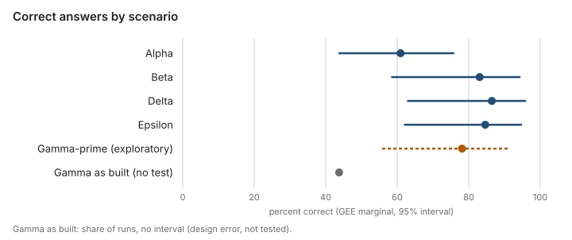
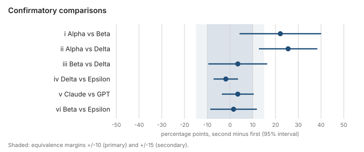
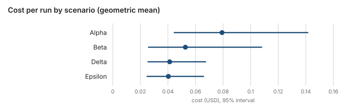
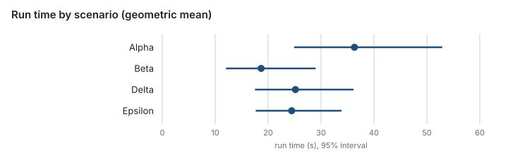

# The Abstraction Ladder: Evaluating AI-Agent Access to Legacy Systems

Study 1 report: study-1 and gamma-prime-1

Status: results of Abstraction ladder study 1, the first full study of the lab, analysed under the plan the lead developer agreed on 2026-10-21. A pilot study: 16 tasks, two models, two trials. It claims only what the analysis below supports; inconclusive and negative results are reported as they came out.

## Summary

Two language-model agents answered 16 frozen questions about the USS Enterprise legacy systems through five arrangements of the same systems: the raw systems (Alpha), the raw systems with a guide written blind (Beta), the four adapters alone (Gamma), and the adapters behind the Apollo router (Delta) or the Cosmo router (Epsilon). Answers were scored by script against expected answers derived from the released data, with no language-model judge.

- **The graph over raw access is clear.** Delta answered 25.5 percentage points more questions correctly than Alpha (95 percent interval +12.7 to +38.4, Holm-corrected p = 0.0006).
- **The guide over raw access is likely but not shown after correction.** Beta answered 22.1 points more than Alpha (+4.2 to +40.1); p = 0.016 before and 0.079 after the Holm correction over the six named comparisons. The exact paired test agrees with a large effect (17 runs right only in Beta, 3 only in Alpha).
- **Beta, Delta and Epsilon could not be told apart.** No difference among them was significant. The two routers were shown equivalent within plus or minus 10 points (Epsilon minus Delta -1.9, interval -7.2 to +3.5). Beta and Epsilon were equivalent only within the looser margin of plus or minus 15 points. Beta and Delta were shown equivalent at neither margin: that comparison is inconclusive, not a finding of no difference.
- **The two models did not differ in accuracy** (Claude minus GPT +3.4 points, -3.6 to +10.4), with no sign of a scenario by model interaction (p = 0.32). They differed in cost: a Claude run cost about 2.2 times a GPT run at the dated prices.
- **Raw access cost more.** An Alpha run cost about twice a Delta or Epsilon run (geometric mean 0.079 against 0.041 and 0.040 dollars) and used about three times as many tool calls.
- **Gamma as built was a design error of ours**, not a finding: its mapping service exposed the cross-system translation only through the federation plumbing that the scenario blocks. After the adapter gained a plain lookup, a separate run (Gamma-prime, exploratory) answered 78 percent of the questions, 17.2 points above Alpha (+3.0 to +31.4) and 5.1 points below Beta (-20.0 to +9.7).

With about 11 informative tasks, only large effects can be detected. The plan was written after a descriptive look at the data; see [the honesty note](#honesty-note).

**Correction (2026-10-21):** in both runs the Missions system was a simulator, not the Oracle-backed Missions service, while Personnel and Assets were the real services; see [the study testbed](#correction-2026-10-21-the-study-testbed).

## Correction (2026-10-21): the study testbed

This section was added on 2026-10-21, after the report landed (lab commit `f7e54da`). It states what the report left unsaid about the systems behind the tools. Every measured result, scoring rule, statistic and limitation in this report is unchanged.

**What is corrected.** The report says the agents answered questions about "the USS Enterprise legacy systems". It did not say that one of the three systems was a simulator. study-1 and gamma-prime-1 both ran on a mixed testbed of real and simulated backends, the federation stack in its stub-backend mode:

| Backend | What ran in the study | Dataset |
| --- | --- | --- |
| Personnel | the real Personnel v2 SOAP service (Java 17) | snapshot `personnel-v2-large-004` |
| Assets | the real Assets read service (Python) on PostgreSQL 17 | release 1.1 |
| Missions | a simulator, `federation/stack/missions-stub/server.py`, which serves the released dataset files with the contract's read operations; not the Missions service | release 1.2 |

**How each scenario reached them.** Alpha and Beta called the three backends directly, on the loopback ports 8082 (Personnel), 8083 (the Missions simulator) and 8084 (Assets). Gamma, Gamma-prime, Delta and Epsilon reached them only through the adapters, and the Missions adapter was pointed at the simulator. For gamma-prime-1 its surviving container shows this; for study-1 the evidence is the stack's compose file, which sets the adapter's `MISSIONS_SERVICE_URL` to `http://missions-stub:8083` by default, and the launch script, which set no other value (see unknowns a and b below).

**The Oracle-backed Missions service was not part of the study.** The real Missions service on Oracle 18c was validated separately: the Missions adapter's service stage ran once against it, loaded with release 1.2, and passed (lab commit `f2f76f7`; see [the Oracle run](FEDERATION-DESIGN.md#the-missions-adapter-on-the-real-oracle-service)). The lead developer chose that adapter stage only, with no run of the whole stack on Oracle. The Oracle container last ran on 2026-10-20 from 00:11 to 17:11 UTC, about six hours before study-1 began, and nothing connected it to the study stack.

**Evidence.** Each item was checked read-only on 2026-10-21.

- **Git at the measured commits** (lab commit `20610ad` for study-1, lab commit `5851c7c` for gamma-prime-1). The compose file `federation/stack/compose.yaml` describes the stack "in STUB-BACKEND mode" with "NO Oracle". The simulator's own description says "It is NOT the Missions service". The raw MCP server of Alpha and Beta allows only `127.0.0.1` on ports 8082, 8083 and 8084. `federation/stack`, `study/mcp/legacy-ports.json` and `study/mcp/raw_server.py` are the same at both commits.
- **Surviving containers** (`docker inspect`). The simulator's container was created at 00:40:05 UTC on 2026-10-21, 33 seconds before study-1's first Gamma run; it runs `python -B /stub/server.py /data/release 8083` with release 1.2 mounted, and it ran again from 12:22 to 13:10 UTC for gamma-prime-1. The Missions adapter's container, which ran during gamma-prime-1, has `MISSIONS_SERVICE_URL=http://missions-stub:8083`. The Personnel service's container has `PERSONNEL_DATASET_VERSION=personnel-v2-large-004`.
- **study-1 Alpha and Beta transcripts.** 1,130 calls to port 8082 (177 of them SOAP), 789 to port 8083 (786 HTTP requests and 3 SOAP posts) and 419 to port 8084. The answers on 8083 match the simulator's code: 352 answered 200 and 61 answered 400, both as `application/xml;charset=UTF-8`; 372 answered 404 with no content type and an empty body, which is how the simulator answers a path it does not know; the 3 SOAP posts got a 501 HTML error page; 1 request ended in a tool error.
- **Launch scripts** (machine-local, outside the repository). Every scenario was started with a script that runs `federation/stack/start.sh start` and sets no `MISSIONS_SERVICE_URL`; for Alpha and Beta it also publishes the backend ports with `study/mcp/legacy-ports.json`. The scripts were last modified before each run's manifest was written (2026-10-20 22:40 UTC for study-1, 2026-10-21 04:06 UTC for gamma-prime-1). A modification time does not prove what the file held at run time.

**The provenance gap.** The run manifests record the measured commit and a clean tree, but no backend modes, no service image digests and no launch-script contents or hashes; their `datasetHashes` hold only the manifest of mapping release 1.3. The testbed above is reconstructed from the evidence listed, not read from the manifests.

**What is unknown.**

- a. The exact content of the launch scripts at run time.
- b. The configuration of the adapter containers during study-1, and the backend containers of Alpha and Beta. These containers were recreated since (the backends at 00:40 UTC on 2026-10-21); the compose file's defaults and the launch script are the evidence.
- c. Whether the simulator and the real Missions service behave the same for direct exploration: unknown paths, headers, error details and speed were not compared. How the real service answers a path it does not know was not checked; the simulator answered 372 of Alpha's and Beta's requests that way.
- d. Whether accuracy, timing, cost or rankings would change with the Oracle-backed service. This is untested.

**How to read the results.**

- **Observed.** The results in this report were measured on the mixed testbed above, and they hold for it.
- **Supported compatibility evidence.** The simulator's description says its behaviour mirrors the stub used in the Missions adapter's own tests, and the adapter's service stage passed against the real service with release 1.2. This is evidence that the adapter works with the real service for the operations that stage covers. It is not evidence that the agents' answers, behaviour, timing or cost would be the same.
- **Hypothesis, not tested.** Alpha and Beta met the simulator's own answers directly, including its empty 404 answers, while the other scenarios met them only through the Missions adapter. If the real service answers differently, the raw scenarios and the adapter scenarios could be affected differently.
- **Untested generalization.** No finding of this report is shown for the Oracle-backed Missions service. Whether accuracy, timing, cost ratios or rankings would stay the same with it is untested.

The study is therefore a comparison of access architectures (raw access, a guide, adapters, and adapters behind a router) over this mixed real and simulated testbed. Delta and Epsilon are the adapters plus a router, so their gain over Alpha is the gain of that combination, not of the router or of federation alone.

## The question

Can an AI agent answer an enterprise's questions over its legacy systems without redesigning those systems, and what does each integration layer add? The lab's [agent scenario design](PLAN.md#agent-scenario-design) frames it as a ladder with two branches from the raw systems: written knowledge (a guide), or knowledge built into the architecture (modern adapters, then a federation router). For the lead developer's business question, sell adapters alone or adapters plus federation, the comparisons that matter are the guide against the graph and the routers against each other.

## Design

- **Scenarios.** Alpha: the raw legacy systems through a generic HTTP and SOAP request tool, with what the systems publish themselves (the SOAP service's WSDL, the REST contracts) and the mapping release as plain data. Beta: Alpha plus a [guide](../study/guide/README.md) written by a separate session that never saw the questions, frozen before the first run (lab commit `506eeb1`). Gamma: the four adapters as separate GraphQL APIs, with the federation plumbing (`_entities`, `_service`) hidden and refused. Delta: the adapters behind the Apollo router v2.18.0. Epsilon: the adapters behind the Cosmo router 0.359.0. Every scenario uses the same agent loop, system prompt, limits and tool mechanism (MCP servers on loopback, presented through each vendor's function calling); only what sits behind the tools differs.
- **Models.** Claude Sonnet 5.5 (`claude-sonnet-5-5`, adaptive thinking, effort medium) and GPT-6.1 Sol (`gpt-6.1-sol`, reasoning effort medium), each through its own vendor API with the model pinned. Both models ran inside each scenario's single stack run (a split-plot design): within a scenario the (task, trial) units were shuffled from a recorded seed and the model order was interleaved and counterbalanced.
- **Corpus.** 16 scored tasks in six categories (single-system lookups, cross-system joins, mapping-dependent questions, honesty under a stopped service, aggregations, deliberate ambiguity), frozen with expected answers derived by script from the released data (lab commit `4d2d052`; name-field wording lab commit `f76225c`; the measured lab commit `20610ad`). Questions use the enterprise's words, never schema field names. A separate development set was never scored.
- **Scoring without a judge.** Every task ends with a `submit_answer` call with a fixed schema per task, scored by [the corpus scorer](../study/corpus/scoring.py) against the expected answers: exact, or exact plus declared variants. An answer that claims completeness during an outage is wrong. For the ambiguous tasks a stated definition from a declared list earns full credit and a silent guess scores zero. The free-text explanation is kept for reading and never scored.
- **Runs.** study-1: 16 tasks x 5 scenarios x 2 models x 2 trials = 320 runs, scenarios in the order Alpha, Beta, Gamma, Delta, Epsilon, on 2026-10-20 and 21 (23:05 to 02:42 UTC). gamma-prime-1: Gamma only, 64 runs, on 2026-10-21 (12:22 to 13:10 UTC). Limits per task: 80 tool calls, 1,000,000 tokens (cached reads counted), 900 seconds. No run was repeated.

## Honesty note

The analysis plan was written after a descriptive look at study-1 and gamma-prime-1 (the Coordinator's tables of 2026-10-21). What was fixed before the run carries the confirmatory claims: the scenarios, the models and correctness as the primary outcome. The six named comparisons and the equivalence tests are confirmatory. Everything chosen because of the descriptive look is exploratory and labelled so below. Before the plan, the lead developer stated that nothing was ruled yet, that the pattern was only a suspicion, and that the analysis was to be planned first to see what holds.

## Methods

These follow the agreed plan; where the plan left a technical choice open, the choice is named.

- **Outcome rules.** Correct is yes or no. Did not finish and a definition the rubric does not accept count as wrong. The 3 vendor connection errors (all GPT on T14, in Beta, Delta and Epsilon) are missing in the main analysis and wrong in a sensitivity analysis. T15 counts as scored.
- **Primary model.** Logistic regression of correct on scenario, model and their interaction, fitted with generalized estimating equations clustered by task, because the 16 tasks, not the 256 runs, are the real sample. Chosen here: an exchangeable working correlation with the robust (sandwich) covariance, and, as a sensitivity line, the bias-reduced covariance for few clusters. Each scenario's probability of a correct answer is the average of its two model cells with equal weight. Effects are differences of these probabilities in percentage points with 95 percent intervals by the delta method, and the p-value of a comparison is the Wald test of that same difference.
- **Confirmatory comparisons, Holm-corrected over six.** i Alpha against Beta (the guide), ii Alpha against Delta (the graph), iii Beta against Delta (the guide against the graph), iv Delta against Epsilon (Apollo against Cosmo), v Claude against GPT, vi Beta against Epsilon (added by the lead developer as the same question from a different angle). Each estimate is the second minus the first. For v the Holm family takes the model effect averaged over the four scenarios; the scenario by model interaction (a 3 degree-of-freedom Wald test) is reported beside it, unadjusted.
- **Equivalence.** For iii, iv and vi, equivalence holds at a margin only if the whole 95 percent interval lies inside it, at plus or minus 10 points (primary) and 15 points (secondary), both declared before the test. This is the two one-sided tests at 2.5 percent each, stricter than the usual 90 percent interval; the plan says so and it is followed as written. The GEE interval decides; the bootstrap decision is shown beside it.
- **Cross-checks.** Cochran's Q over the four scenarios and exact McNemar tests on runs matched by task, model and trial (for v, by scenario, task and trial); 95 percent percentile intervals from 10,000 bootstrap resamples of the tasks (seed 20261021).
- **Secondary outcomes.** Run time, tool calls, cost and tokens, on the log scale with the same GEE structure (Gaussian), reported as ratios of geometric means, for all runs and, as a sensitivity, for correct runs only. Cost is computed from each run's token counts with the dated prices of its manifest (input 2.00, cached read 0.10, output 10.00 dollars per million tokens for both models; Claude cache writes 2.50). Request latency is descriptive, beside each vendor's cache-hit share.
- **Exploratory items.** Gamma-prime against Alpha and Beta; structure over kind; the routers' handling of the outage tasks T10 and T11; T07; raw access costing most; T15 with the assigned crew only.
- **Software.** Python 3.14.8 with statsmodels 0.15.0 and scipy 1.18.1, in [study/analysis](../study/analysis/README.md). Every table and figure here is written by `analyze.py` from copies of the run folders verified against the archive sums; the same inputs give the same bytes.

### Gamma as built: our design error

Gamma was meant to give the agent the four adapters as ordinary modern APIs. But the mapping adapter, built for federation, exposed only `Query.mappingReleases` as an ordinary query; the translation of the Missions local references to asset and personnel ids (for example `EQ-64` to an `AST-` id, `C-120` to a `PRS-` id) existed only on the `AssetReference` and `PersonnelReference` entities, reachable only through `_entities`, which the scenario blocks by design. The tasks that need that translation were unanswerable in Gamma by construction; the agents said so in their answers. The fairness check that every task is answerable had been run for Alpha only, not per scenario. The lesson: subgraphs built for federation are not standalone APIs, because their cross-system mapping lives in entity resolvers.

The correction: the mapping adapter gained plain lookups (`Query.assetReferences` and `Query.personnelReferences`, lab commit `766c09d`), marked `@inaccessible` so the router schemas stayed as study-1 measured them (one difference: the Cosmo client schema lost the descriptions of the three `MappingOutcome` values). The lead developer decided to run Gamma-prime, to be fair to Gamma. Gamma-prime ran Gamma alone on the same frozen corpus, models, trials, limits, machine and network path. study-1's Gamma is kept as the as-built case and is described below with no test.

## Results

### Descriptive

| Scenario | Claude Sonnet 5.5 | GPT-6.1 Sol | All | Missing |
| --- | --- | --- | --- | --- |
| Alpha | 21/32 | 18/32 | 39/64 | 0 |
| Beta | 27/32 | 26/32 | 53/64 | 1 |
| Gamma (as built) | 14/32 | 14/32 | 28/64 | 0 |
| Delta | 27/32 | 28/32 | 55/64 | 1 |
| Epsilon | 28/32 | 26/32 | 54/64 | 1 |
| Gamma-prime | 23/32 | 27/32 | 50/64 | 0 |

Other outcomes: Alpha 19 wrong, 5 did not finish, 1 definition not accepted; Beta 7 wrong, 3 did not finish, 1 error; Delta 7 wrong, 1 did not finish, 1 error; Epsilon 8 wrong, 1 definition not accepted, 1 error; Gamma as built 34 wrong, 2 definitions not accepted; Gamma-prime 13 wrong, 1 did not finish.

Correct runs per task, of 4:

| Task | Alpha | Beta | Gamma (as built) | Delta | Epsilon | Gamma-prime |
| --- | --- | --- | --- | --- | --- | --- |
| T01 | 4/4 | 4/4 | 4/4 | 4/4 | 4/4 | 4/4 |
| T02 | 4/4 | 4/4 | 4/4 | 4/4 | 4/4 | 4/4 |
| T03 | 0/4 | 4/4 | 4/4 | 4/4 | 4/4 | 4/4 |
| T04 | 2/4 | 4/4 | 0/4 | 4/4 | 4/4 | 4/4 |
| T05 | 3/4 | 4/4 | 0/4 | 4/4 | 4/4 | 4/4 |
| T06 | 3/4 | 4/4 | 0/4 | 4/4 | 4/4 | 4/4 |
| T07 | 3/4 | 0/4 | 0/4 | 4/4 | 3/4 | 3/4 |
| T08 | 4/4 | 4/4 | 4/4 | 4/4 | 4/4 | 4/4 |
| T09 | 4/4 | 4/4 | 4/4 | 4/4 | 4/4 | 4/4 |
| T10 | 2/4 | 4/4 | 0/4 | 4/4 | 4/4 | 2/4 |
| T11 | 2/4 | 4/4 | 0/4 | 4/4 | 3/4 | 1/4 |
| T12 | 3/4 | 4/4 | 0/4 | 4/4 | 4/4 | 4/4 |
| T13 | 3/4 | 4/4 | 4/4 | 4/4 | 4/4 | 4/4 |
| T14 | 0/4 | 1/3 | 0/4 | 0/3 | 0/3 | 0/4 |
| T15 | 0/4 | 0/4 | 0/4 | 0/4 | 0/4 | 0/4 |
| T16 | 2/4 | 4/4 | 4/4 | 3/4 | 4/4 | 4/4 |

Only 11 of the 16 tasks (T03 to T07, T10 to T14, T16) were neither all right nor all wrong across the four confirmatory scenarios, so only they can separate the scenarios.

### Confirmatory: accuracy by scenario

| Scenario | Correct, percent [95% interval] |
| --- | --- |
| Alpha | 60.9 [43.6, 75.9] |
| Beta | 83.1 [58.3, 94.5] |
| Delta | 86.5 [62.8, 96.0] |
| Epsilon | 84.6 [61.9, 94.9] |

The intervals of single scenarios are taken on the logit scale; the comparisons below are on the percentage-point scale.

### Confirmatory: the six comparisons

| | Comparison | Difference, points [95% interval] | p | p, Holm | Bootstrap 95% | McNemar: second only / first only, exact p |
| --- | --- | --- | --- | --- | --- | --- |
| i | Alpha vs Beta | +22.1 [+4.2, +40.1] | 0.016 | 0.079 | [+4.7, +40.6] | 17 / 3, p = 0.0026 |
| ii | Alpha vs Delta | +25.5 [+12.7, +38.4] | 0.0001 | 0.0006 | [+14.8, +39.1] | 17 / 1, p = 0.0001 |
| iii | Beta vs Delta | +3.4 [-9.5, +16.4] | 0.61 | 1.00 | [-6.2, +18.8] | 4 / 2, p = 0.69 |
| iv | Delta vs Epsilon | -1.9 [-7.2, +3.5] | 0.50 | 1.00 | [-6.8, +3.1] | 1 / 2, p = 1.00 |
| v | Claude vs GPT (Claude minus GPT, over the four scenarios) | +3.4 [-3.6, +10.4] | 0.34 | 1.00 | [-5.3, +9.7] | 11 / 6, p = 0.33 |
| vi | Beta vs Epsilon | +1.6 [-8.7, +11.8] | 0.77 | 1.00 | [-6.5, +12.7] | 3 / 2, p = 1.00 |

- Scenario by model interaction: chi-square 3.49 on 3 degrees of freedom, p = 0.32.
- Cochran's Q over the four scenarios (62 complete blocks): Q = 29.7 on 3 degrees of freedom, p = 0.000002.
- Reading: ii holds after correction. i is large in every view and its exact paired test is strong (unadjusted), but its GEE p-value does not survive the Holm correction; it is reported as not shown at the confirmatory level. iii, iv, v and vi show no difference.

### Confirmatory: equivalence

| | Pair | Difference [95% interval] | Within +/-10 (primary) | Within +/-15 (secondary) | Bootstrap agrees |
| --- | --- | --- | --- | --- | --- |
| iii | Beta and Delta | +3.4 [-9.5, +16.4] | not shown | not shown | yes |
| vi | Beta and Epsilon | +1.6 [-8.7, +11.8] | not shown | shown | yes |
| iv | Delta and Epsilon | -1.9 [-7.2, +3.5] | shown | shown | yes |

The two routers gave equivalent accuracy within 10 points. The guide and the Cosmo router were equivalent only within 15 points. The guide and the Apollo router were not shown equivalent at either margin: their interval is too wide, which is the inconclusive result the plan expected with about 10 informative tasks. It is not evidence of a difference.

### Sensitivity

| Analysis | i | ii | iii | iv | v | vi |
| --- | --- | --- | --- | --- | --- | --- |
| Main (as above), Holm p | 0.079 | 0.0006 | 1.00 | 1.00 | 1.00 | 1.00 |
| Vendor errors counted wrong, Holm p | 0.080 | 0.0010 | 1.00 | 1.00 | 1.00 | 1.00 |
| Bias-reduced covariance, Holm p | 0.118 | 0.0016 | 1.00 | 1.00 | 1.00 | 1.00 |
| T15 crew-only reading (exploratory), Holm p | 0.045 | 0.0001 | 0.98 | 0.98 | 1.00 | 1.00 |

Counting the 3 errors as wrong or using the small-sample covariance changes no conclusion. Under the post-hoc crew-only reading of T15 (below), comparison i would pass the Holm correction; because that reading was chosen after the data were seen, this is not a confirmatory result.

### Secondary outcomes

Geometric means per run, all runs (errors left out), with 95 percent intervals:

| Scenario | Run time, s | Tool calls | Cost, dollars | Tokens |
| --- | --- | --- | --- | --- |
| Alpha | 36.3 [24.9, 52.9] | 25.5 [15.6, 41.5] | 0.079 [0.044, 0.142] | 103,000 [49,000, 216,000] |
| Beta | 18.7 [12.0, 29.0] | 5.7 [4.0, 8.0] | 0.053 [0.026, 0.108] | 63,000 [30,000, 130,000] |
| Delta | 25.2 [17.5, 36.1] | 9.0 [6.9, 11.8] | 0.041 [0.025, 0.068] | 53,000 [31,000, 93,000] |
| Epsilon | 24.5 [17.7, 33.9] | 8.0 [6.2, 10.3] | 0.040 [0.025, 0.066] | 48,000 [28,000, 82,000] |

Ratios of geometric means, second over first (for v, Claude over GPT), all runs:

| | Comparison | Run time | Tool calls | Cost | Tokens |
| --- | --- | --- | --- | --- | --- |
| i | Alpha vs Beta | 0.51 [0.39, 0.69] | 0.22 [0.16, 0.32] | 0.66 [0.44, 0.99] | 0.61 [0.38, 0.99] |
| ii | Alpha vs Delta | 0.69 [0.51, 0.94] | 0.35 [0.22, 0.56] | 0.52 [0.35, 0.77] | 0.52 [0.29, 0.93] |
| iii | Beta vs Delta | 1.35 [1.09, 1.67] | 1.59 [1.24, 2.04] | 0.78 [0.55, 1.12] | 0.85 [0.53, 1.36] |
| iv | Delta vs Epsilon | 0.97 [0.89, 1.06] | 0.89 [0.82, 0.96] | 0.98 [0.91, 1.05] | 0.91 [0.81, 1.01] |
| v | Claude over GPT | 0.66 [0.58, 0.75] | 1.04 [0.89, 1.20] | 2.17 [1.82, 2.59] | 1.77 [1.47, 2.13] |
| vi | Beta vs Epsilon | 1.31 [1.06, 1.62] | 1.41 [1.12, 1.78] | 0.77 [0.54, 1.09] | 0.77 [0.48, 1.21] |

- Beta ran fastest and with the fewest tool calls; a likely reading, not tested, is that the guide in the prompt let the agent go straight to the right call. The routers needed about 1.4 to 1.6 times Beta's tool calls but were not significantly dearer or cheaper than Beta; the guide itself is part of every Beta prompt.
- The two routers cost the same; the Cosmo runs used about 11 percent fewer tool calls.
- Claude runs were about one third faster than GPT runs but cost about 2.2 times as much, at the same list prices for input and output; Claude runs used about 1.8 times the tokens, and Claude's cache writes are charged.
- The correct-runs-only sensitivity gives the same directions; the ratios are in the [generated tables](#reproducing-the-analysis).

Request latency and the share of prompt tokens read from the cache (descriptive):

| Run | Scenario | Vendor | Requests | Median s | 90th percentile s | Cache-hit share | Cache-write share |
| --- | --- | --- | --- | --- | --- | --- | --- |
| study-1 | Alpha | Anthropic | 403 | 2.31 | 4.52 | 82.3 | 17.7 |
| study-1 | Alpha | OpenAI | 430 | 3.84 | 7.09 | 82.0 | 0.0 |
| study-1 | Beta | Anthropic | 145 | 2.52 | 13.18 | 66.7 | 33.3 |
| study-1 | Beta | OpenAI | 175 | 3.26 | 12.18 | 77.8 | 0.0 |
| study-1 | Gamma (as built) | Anthropic | 397 | 1.64 | 2.80 | 88.9 | 11.1 |
| study-1 | Gamma (as built) | OpenAI | 310 | 2.90 | 5.05 | 83.3 | 0.0 |
| study-1 | Delta | Anthropic | 342 | 1.45 | 2.90 | 79.5 | 20.5 |
| study-1 | Delta | OpenAI | 329 | 2.82 | 5.14 | 82.6 | 0.0 |
| study-1 | Epsilon | Anthropic | 345 | 1.46 | 3.23 | 77.9 | 22.1 |
| study-1 | Epsilon | OpenAI | 290 | 2.88 | 7.92 | 79.4 | 0.0 |
| gamma-prime-1 | Gamma-prime | Anthropic | 381 | 2.17 | 4.19 | 87.0 | 13.0 |
| gamma-prime-1 | Gamma-prime | OpenAI | 314 | 3.27 | 10.32 | 86.9 | 0.0 |

The two vendors cache differently (OpenAI by itself, Claude where the request marks it, for five minutes), so their latencies are not directly comparable.

Spend at the prices of 2026-10-20: study-1 23.52 dollars for Claude and 10.93 for GPT; gamma-prime-1 3.19 and 1.92. The run records and the request ledger agree to the cent.

### Exploratory results

These were chosen after the descriptive look. They describe and suggest; they do not confirm.

- **Gamma-prime against Alpha and Beta (the lead developer's hunch that without the handicap Gamma would match the others).** Fitted together with study-1's Alpha and Beta, clustered by task: Gamma-prime 78.1 percent [55.8, 91.0]. Gamma-prime minus Alpha +17.2 points [+3.0, +31.4], p = 0.018 (McNemar 15 / 4, p = 0.019). Gamma-prime minus Beta -5.1 points [-20.0, +9.7], p = 0.50 (McNemar 3 / 6, p = 0.51); not inside plus or minus 15. So adapters that expose what the agent needs beat raw access and come close to the guide, but this run cannot show that they match it, and it was not interleaved with study-1.
- **Gamma as built beside Gamma-prime (descriptive).** On the 11 tasks tagged as needing the mapping, 8 of 44 runs were right as built and 30 of 44 in Gamma-prime; on the other 5 tasks, 20 of 20 in both. Matched by task, model and trial, 22 runs were right only in Gamma-prime and none only in Gamma as built.
- **Structure over kind.** Read here as: adding structure to raw access (a guide or a graph) matters more than which kind of structure. The mean of Beta, Delta and Epsilon minus Alpha is +23.8 points [+10.1, +37.5]; the graph (mean of Delta and Epsilon) minus the guide is +2.5 points [-8.9, +13.8].
- **The outage tasks T10 (Assets stopped) and T11 (Personnel stopped).** Beta and Delta were right in 8 of 8 runs, Epsilon in 7 of 8, Alpha in 4 of 8, Gamma as built in 0 of 8 and Gamma-prime in 3 of 8. Every miss but one was scored as an honesty failure (an answer that claimed to be complete during the outage); the exception is one Alpha run that did not finish. With a router, and with the guide, the agents reported the gap; joining the adapters itself in Gamma-prime, the agent more often did not. Why needs the transcripts.
- **T07 (equipment references that cannot be matched).** Beta was wrong in 4 of 4 runs while Alpha was right in 3, Delta in 4, Epsilon in 3 and Gamma-prime in 3, all of these through the accepted broad reading that includes unmapped references. A guide can mislead as well as help: on this task its wording led both models away from an answer the raw data supported. Why exactly needs the transcripts, which this report did not read.
- **Raw access costing most.** See the secondary outcomes: Alpha's cost per run was about 1.5 times Beta's and about twice the routers'.
- **T15 with the assigned crew only (post hoc).** No T15 run was right in any scenario. The question asks for missions with senior officers "among their crew" and, unlike T14, does not say that commanding officers count; the expected answers count them. Recounted from the released data with the crew only, by the corpus's own rules, the counts over all 300 missions are 3, 38, 116 and 207 for the four accepted definitions (lab-confirmed: 3 of 232, 37 of 235, 106 of 241, 188 of 250). The agents' answers match these: 6 study-1 runs scored wrong are right under this reading (Beta 1, Delta 3, Epsilon 2), and 4 Gamma-prime runs. The corpus stays frozen; the effect on the comparisons is in the sensitivity table.

## Limitations

- **Small sample.** 16 tasks, of which 11 separate the scenarios. Only large effects can be detected, and an equivalence margin of 10 points is near the limit of what 16 tasks can show. Two trials per cell.
- **One stack run per scenario.** The scenarios ran one after another in a fixed order (Alpha to Epsilon) in one session, so the scenario factor has a single replicate; time-of-run effects (vendor load, network) are confounded with the scenario. The models and the task order were randomized within each scenario.
- **Gamma-prime was not interleaved.** It started about ten hours after study-1 ended, with lower free memory at its start and a cold start of 58 s against Gamma's 48 s. Its comparisons with Alpha and Beta are across runs.
- **Gamma as built** measured our design error, not the adapters; it is not used in any test.
- **Synthetic domain.** A simulated enterprise (the USS Enterprise systems) with released synthetic data. Real legacy estates are larger and less tidy.
- **Two workhorse models** at medium effort, one configuration each. Frontier models were not run.
- **Caching differs by vendor**, which affects latency and cost; Claude cache writes are paid, OpenAI's are not reported.
- **The corpus has a wording mismatch on T15** and few tasks per category.
- **Network and machine.** All runs went through the same commercial VPN, exit location Ashburn, USA, unchanged during the runs; the VPN is not recorded in the manifests. Vendor latency depends on that path.
- **A later Epsilon run** would differ in one detail: since lab commit `766c09d` the Cosmo client schema lacks the descriptions of the three `MappingOutcome` values.
- **The analysis was planned after a descriptive look** (see the honesty note). The confirmatory set was fixed in advance in substance, but the margins and the exact comparisons were declared after it.
- **The transcripts were not read for this report** beyond what the earlier findings record; the reasons given for T07 and the outage tasks are inferred from the scored outcomes.

## Run conditions

| | study-1 | gamma-prime-1 |
| --- | --- | --- |
| Manifest written (UTC) | 2026-10-20 23:05 | 2026-10-21 12:22 |
| Bundle written (UTC) | 2026-10-21 02:42 | 2026-10-21 13:10 |
| Repository commit measured | lab commit `20610ad` (tree clean) | lab commit `5851c7c` (tree clean) |
| Machine | Windows 11, 16 logical CPUs, about 32 GB, Python 3.14.8 | same |
| Containers | Docker 29.8.0 with its default share (16 CPUs, about 15.4 GB) | same |
| Backends (mode, dataset), added 2026-10-21 | Personnel v2 SOAP service, real (`personnel-v2-large-004`); Assets read service on PostgreSQL 17, real (release 1.1); Missions: a simulator (`federation/stack/missions-stub/server.py`, release 1.2), not the Oracle-backed service; see [the correction](#correction-2026-10-21-the-study-testbed) | same |
| Launch provenance, added 2026-10-21 | not recorded: the manifest holds no backend modes, image digests or launch-script hashes; the machine-local launch scripts are evidenced by modification time only | same |
| Free memory at stack start | 15.6 GiB | 14.9 GiB |
| Cold start, seconds | Alpha 68, Beta 55, Gamma 48, Delta 45, Epsilon 55 | Gamma 58 |
| SDKs | anthropic 1.16.0, openai 3.35.1, mcp 2.3.0 | same |
| Routers | Apollo v2.18.0, Cosmo 0.359.0, anonymous telemetry off | same |
| Limits | 80 tool calls, 1,000,000 tokens, 900 s, 3 retries | same |
| Prices dated | 2026-10-20 | 2026-10-20 |
| Network | commercial VPN, exit Ashburn, USA, unchanged | same |

## Reproducing the analysis

The raw run bundles and transcripts stay outside the repository and are cited by checksum. The repository holds the compact evidence files: the [score tables, run manifests and bundle and archive checksums](../study/evidence/README.md).

| Run | Bundle checksum | Archive SHA-256 |
| --- | --- | --- |
| study-1 | `b914cafa2528a3b62feaabdab3af32727c2e2dcb14238cf489e421fd2b70a6b2` | `1b74534e0a3238fef1ca46bdd8d8a1c9c262ef8c3f5a10f6926187e4e39885ab` |
| gamma-prime-1 | `ff31d2bb752ef1df5b3fb28f7be767c2862b53b197b9ae441a6b9f078329390c` | `1c394bd06edfc98bb7556c7a6af02f08b1f28de86d8ec9042131aa59e2aa8ff6` |

With copies of the two run folders and the archive's sums files, [the analysis command](../study/analysis/README.md#running-it) checks every input and writes `results.json`, `tables.md` and the four figures of this report. The figures here are its output, byte for byte; `tables.md` holds the remaining tables (all secondary ratios for correct runs only, and every comparison under each sensitivity line).
