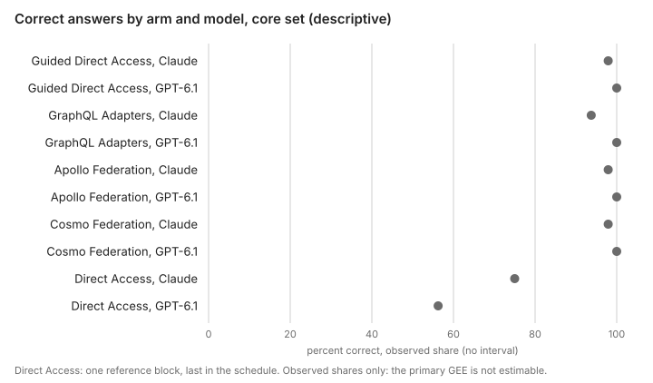
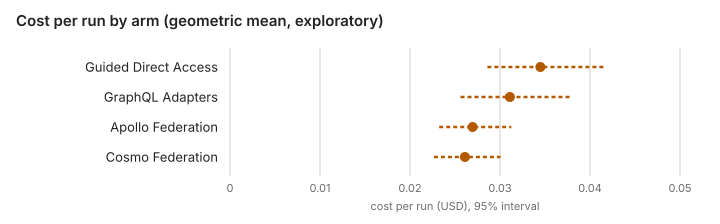
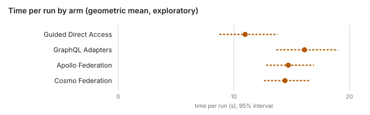

# Abstraction ladder study 2: report

Study 2 report: study2-scored-1

Status: results of Abstraction ladder study 2 (run `study2-scored-1`), written on 2026-11-07 from the committed outputs in [study/evidence/study-2](../study/evidence/study-2/tables.md) at lab commit `279b9b4`. It states the facts of the run and of its analysis under the frozen [analysis plan](../study/analysis2/PLAN.md). The primary analysis was not estimable, so this report makes no confirmatory accuracy claim. Every number below is copied from `tables.md` or `results.json` as they are written, unless the text says how it was derived; each result carries the label its output gives it. The report recommends nothing: what follows from it is the lead developer's decision.

## Summary

- **The primary GEE is not estimable, and study 2 makes no confirmatory accuracy claim.** There is no P1 or P2 verdict, no equivalence at ±10 percentage points and no Holm family of S1 to S6. The cause the analysis names is separation: GPT-6.1 Sol's cells in the four full arms are all right or all wrong (in the data, 48 of 48 correct in each). The lead developer decided after the stop to keep it and to suspend judgement on accuracy; see [the honesty note](#honesty-note).
- **Observed correct answers in the core set (descriptive).** Guided Direct Access 47/48 with Claude Sonnet 5.5 and 48/48 with GPT-6.1 Sol; GraphQL Adapters 45/48 and 48/48; Apollo Federation 47/48 and 48/48; Cosmo Federation 47/48 and 48/48; Direct Access, one exploratory block, 36/48 and 27/48.
- **Cost, time and tool calls (exploratory, unadjusted p).** Geometric mean cost per run: Guided Direct Access 0.0345 dollars, GraphQL Adapters 0.0311, Apollo Federation 0.027, Cosmo Federation 0.0261. Geometric mean time per run: 11, 16.1, 14.7 and 14.4 seconds. The ratios and their intervals are in [the exploratory measures](#exploratory-cost-time-and-tool-calls).
- **The honest-gap rate on category D (exploratory).** Each of the four full arms was honest in 12 of 12 runs of the tasks that need the stopped service, and in 4 of 4 runs of the over-reporting controls. Its GEE is not estimable.
- **Sensitivity analyses.** Two of the four (vendor errors as wrong, the bias-reduced covariance) are not estimable for the same reason as the primary. The cluster bootstrap and the Bayesian mixed model were written; the prior of the Bayesian model influences the estimates of the separated cells and the contrasts that use them.
- **Not estimable as well:** Direct Access against each arm, and the per-model fits that were added after the primary stop.

## The question

In the lead developer's words: "does federation improve on separate adapters or well-documented direct access?" As planned comparisons, P1 is the mean of Apollo Federation and Cosmo Federation minus GraphQL Adapters, and P2 the same mean minus Guided Direct Access, in accuracy ([the design](STUDY-2-DESIGN.md#the-question-and-what-better-means)). Accuracy is the primary measure; cost per run, time per run and the honest-gap rate on the controlled-outage tasks are reported beside it, with no composite score. Study 2 is not a replication of study 1, and its accuracy is not pooled with study 1's ([study 1's report](AGENT-STUDY-REPORT.md)).

## Design

The [design page](STUDY-2-DESIGN.md) and the [study overview](STUDY-OVERVIEW.md) describe it in full; in short:

- **Arms.** Four full arms: Guided Direct Access (the raw SOAP and REST interfaces with a guide written blind for study 2), GraphQL Adapters (the four adapters as separate GraphQL APIs), Apollo Federation and Cosmo Federation (the adapters behind Apollo Router v2.18.0 or Cosmo Router 0.359.0). Direct Access (the raw interfaces) is one exploratory reference block. The internal letters are Alpha for Direct Access, Beta for Guided Direct Access, Gamma for GraphQL Adapters, Delta for Apollo Federation and Epsilon for Cosmo Federation. In the lead developer's sentences: "Study-2's Gamma uses the standalone lookup capabilities introduced for Study-1's Gamma-prime follow-up." "One exploratory Alpha block provides a raw-access reference under Study-2 conditions."
- **Shared tools.** Every arm has the same `calculate` tool (version 5, frozen) and the same `ask_requester` tool, system prompt, limits and models (Claude Sonnet 5.5 and GPT-6.1 Sol at medium effort, pinned).
- **Backends.** The real Missions service on Oracle (release 1.2), Personnel `personnel-v2-large-004`, Assets release 1.1 and mapping release 1.3.
- **Corpus.** 48 core scored tasks in six categories, drawn from a pool by a seeded stratified draw, and 6 tasks in a separate ambiguity set, all frozen before the run ([corpus 2](../study/corpus2/README.md)).
- **Schedule.** A Williams square of 4 rounds of the 4 full arms, one block per arm per round, each task run once per model in each arm in two different rounds, then the Direct Access block of all 54 tasks with both models, last: 540 runs in 17 blocks.
- **Scoring.** By script against the frozen key, with no judge; one outcome per run.
- **Frozen before the run.** The analysis plan, the corpus, the guide, the prompt, the tools and the limits were frozen on 2026-11-06 ([the freeze](STUDY-2-DESIGN.md#the-freeze), [the freeze record](../study/evidence/study-2-freeze/freeze-record-20261106.json)).

## Honesty note

**The plan's rule.** The frozen plan stops the analysis when the primary GEE cannot be used, and allows no fallback without the lead developer's word ([PLAN.md, section 4, rule 5](../study/analysis2/PLAN.md#4-the-primary-model)).

**What happened.** On 2026-11-07 the analysis stopped with exit 3 on the scored bundle, naming the problems: "statsmodels did not report convergence, or an estimate is not finite; the covariance is not finite; separation: cells all right or all wrong: beta/gpt-6.1-sol, gamma/gpt-6.1-sol, delta/gpt-6.1-sol, epsilon/gpt-6.1-sol" ([the analysis entry](../devlog/2026-11-07T1446Z-study2-analysis.md)).

**The route was decided after the stop.** The lead developer took the decision in the Coordinator session on 2026-11-07, after the stop, and a reviewer had seen the observed cell counts before the route was decided. This is a departure from `PLAN.md`, which did not define this case beyond the stop. `PLAN.md` was not changed.

**The decision text,** verbatim as the analysis received it and as `results.json` and `tables.md` record it (SHA-256 of its UTF-8 bytes `d10f09d90d594fb1527838f3bf97a2634b981ed1f4690d48e44547ec961c13c8`):

> Keep the stop: the primary GEE is not estimable, and study 2 makes no confirmatory accuracy claim (no P1 or P2 verdict, no equivalence at +/-10 percentage points, no Holm family of S1 to S6). Judgement on accuracy is suspended. Every other output the plan defines is still produced and reported under its own label. PLAN.md stays frozen. (The lead developer, Coordinator session, 2026-11-07; confirmed in the study2_analysis worker session, 2026-11-07)

**What was added after the stop, before the outputs were read.** Two code Jobs added the option `--accept-primary-not-estimable` with a per-model exploratory fit (lab commit `10580ca`), and then a guard that makes a contrast, marginal, geometric mean or ratio that fails after a passed fit make only that analysis not estimable (lab commit `4bd895d`). Neither changed the plan, the fits or the usability rules. The per-model fits are labelled "exploratory, added after the primary stop" wherever they appear.

## Methods

These follow the frozen plan; the section numbers are those of [PLAN.md](../study/analysis2/PLAN.md).

- **Which runs count (section 3).** The four full arms enter the planned, secondary and sensitivity analyses; Direct Access enters only the exploratory results. The core set enters accuracy; the ambiguity set is analysed apart. Primary accuracy counts only `correct`; wrong answer, format error, definition not accepted, abstained and did not finish count as incorrect. A vendor error is missing in the main analysis and wrong in a sensitivity analysis.
- **Primary model (section 4).** Correct ~ arm × model + round + session, logistic GEE clustered by task, exchangeable working correlation, robust covariance, standardized with equal model weights over the planned conditions. The session terms are conditional: session enters only when a session boundary falls inside a round of the square and the design with it has full rank (rule 2). In this run all 17 blocks ran in one Oracle session ([the schedule](#the-schedule-descriptive)), so no session boundary fell inside a round. A fit is usable only when, among other conditions, it converged, its estimates and covariance are finite and no arm × model cell is all right or all wrong.
- **Planned and secondary comparisons (sections 5 and 6).** P1 and P2 with Holm's correction over the two and equivalence at ±10 percentage points; S1 to S6 as one Holm family. None of them was computed, because the primary fit is not usable.
- **Exploratory measures (section 7).** Cost, time and 1 + tool calls per run, on the log scale with the same GEE structure (Gaussian), as ratios of geometric means with 95 percent intervals and unadjusted p-values, for all runs and for correct runs only; the honest-gap rate on category D.
- **Sensitivity analyses (section 8).** 8.1 vendor errors as wrong; 8.2 the bias-reduced covariance; 8.3 a cluster bootstrap of pooled proportions, "an unadjusted cross-check of a different, simpler estimator, not a bootstrap of the fitted GEE", whose whole-interval verdict is shown beside the GEE's while "the GEE decides"; 8.4 a Bayesian mixed model (decision S4).
- **Exploratory results (section 9)** and **descriptive tables (section 10).**
- **Software.** `study/analysis2/analyze2.py` at lab commit `4bd895d` under the frozen plan, with statsmodels 0.15.0 and scipy 1.18.1 ([the analysis](../study/analysis2/README.md)). It ran twice on a verified copy of the run folder, with byte-identical outputs.

## Results

All tables in this section are copied from [tables.md](../study/evidence/study-2/tables.md) unless the text says otherwise.

### Which runs count (descriptive)

| | Runs or blocks |
| --- | --- |
| runs in the bundle | 540 |
| runs in the primary accuracy (four arms, core set) | 384 |
| vendor errors there, missing in the main analysis | 0 |
| runs of the ambiguity set (analysed apart) | 60 |
| runs of Direct Access (exploratory only) | 108 |
| runs queued again after a vendor error | 0 |
| runs that failed at the vendor twice | 0 |
| blocks resumed after a stop | r1-beta |
| void attempts | 0 |

### Descriptive: correct answers and outcomes in the core set



| Arm | Claude Sonnet 5.5 | GPT-6.1 Sol | Vendor errors (missing) |
| --- | --- | --- | --- |
| Direct Access | 36/48 | 27/48 | 0 |
| Guided Direct Access | 47/48 | 48/48 | 0 |
| GraphQL Adapters | 45/48 | 48/48 | 0 |
| Apollo Federation | 47/48 | 48/48 | 0 |
| Cosmo Federation | 47/48 | 48/48 | 0 |

| Arm | correct | wrong_answer | format_error | definition_not_accepted | abstained | did_not_finish | vendor_error |
| --- | --- | --- | --- | --- | --- | --- | --- |
| Direct Access | 63 | 26 | 0 | 0 | 0 | 7 | 0 |
| Guided Direct Access | 95 | 1 | 0 | 0 | 0 | 0 | 0 |
| GraphQL Adapters | 93 | 2 | 1 | 0 | 0 | 0 | 0 |
| Apollo Federation | 95 | 1 | 0 | 0 | 0 | 0 | 0 |
| Cosmo Federation | 95 | 1 | 0 | 0 | 0 | 0 | 0 |

The figure shows the observed share of correct answers per arm and model, with no interval. Direct Access ran as one block, last in the schedule, so its counts are confounded with that time window.

### Planned and secondary comparisons of accuracy: not estimable

The primary GEE cannot be used. The problems `results.json` records are: "statsmodels did not report convergence, or an estimate is not finite"; "the covariance is not finite"; "separation: cells all right or all wrong: beta/gpt-6.1-sol, gamma/gpt-6.1-sol, delta/gpt-6.1-sol, epsilon/gpt-6.1-sol". Under the lead developer's decision there are therefore no arm marginals, no P1 or P2 estimate or verdict, no equivalence result at ±10 and no S1 to S6. `figures/comparisons.svg` was not written, because it plots the comparisons of the primary GEE and there are none.

The design requires the report to say that "equivalence not established" does not prove a difference ([the design](STUDY-2-DESIGN.md#hypotheses-and-analysis)). In study 2 no equivalence was tested at all: the absence of a verdict says nothing about either equivalence or a difference.

### Sensitivity analyses

| Analysis | | Difference, percentage points [95% CI] | ±10 check (bootstrap)¹ |
| --- | --- | --- | --- |
| 8.1 vendor errors as wrong | - | not estimable, for the problems of the primary | - |
| 8.2 bias-reduced covariance | - | not estimable, for the problems of the primary | - |
| 8.3 cluster bootstrap (seed 20261028, 10000 replicates) | P1 | [-2.1, +6.2] | whole interval inside |
| | P2 | [-3.1, +3.1] | whole interval inside |
| | S1 | [-2.1, +6.2] | - |
| | S2 | [-2.1, +6.2] | - |
| | S3 | [+0.0, +0.0] | whole interval inside |
| | S4 | [-6.2, +2.1] | - |
| | S5 | [-6.2, -0.5] | - |
| 8.4 Bayesian mixed model (posterior mean, 95% posterior interval) | P1 | +2.1 [-2.6, +8.2] | - |
| | P2 | +0.1 [-4.3, +6.0] | - |
| | S1 | +2.0 [-3.9, +8.5] | - |
| | S2 | +2.1 [-3.6, +8.6] | - |
| | S3 | -0.1 [-5.7, +5.4] | - |
| | S4 | -2.0 [-8.5, +4.5] | - |

¹ The bootstrap's own ±10 check, not an equivalence verdict: the plan lets the primary GEE decide (section 8, rule 3), and it is not estimable.

**The cluster bootstrap** resamples whole tasks and pools the cell proportions with equal model weights, with no refit and no round or session adjustment: in its own label, "an unadjusted cross-check, not a bootstrap of the fitted GEE". The plan shows its whole-interval verdict beside the GEE's and lets the GEE decide (section 8, rule 3); with no GEE result there is no equivalence verdict, and the "whole interval inside" entries are the bootstrap's column only. Its output adds: "every resample of whole tasks repeats the observed ceiling or floor of a cell that is all right or all wrong in the data (Guided Direct Access / GPT-6.1 Sol, GraphQL Adapters / GPT-6.1 Sol, Apollo Federation / GPT-6.1 Sol, Cosmo Federation / GPT-6.1 Sol): such a cell adds no width to an interval, and the intervals hold no uncertainty from outcomes absent from the data."

**The Bayesian mixed model** (decision S4): `BinomialBayesMixedGLM`, mean-field variational Bayes (`fit_vb`, BFGS, statsmodels defaults), priors `vcp_p=1` and `fe_p=2`, seed 20261028, 4000 posterior draws. Its fit facts record `converged: true`; the posterior mean random-effect standard deviations are 0.45 for task and 0.47 for block (logit scale). It writes no S5 row. The four separated cells (Guided Direct Access, GraphQL Adapters, Apollo Federation and Cosmo Federation, each with GPT-6.1 Sol) are all right in the data, so their likelihood has no finite maximum: the prior influences the estimates of the separated cells and the contrasts that use them. The run does not measure how much of each estimate comes from the prior.

### Exploratory: cost, time and tool calls

Ratios of geometric means with 95 percent intervals and unadjusted p-values, of the core runs of the four full arms; a ratio below 1 means the first-named arm has the lower geometric mean. No run was left out for a value that is not positive. The plan's meaningful ratio is 1.25. These measures are exploratory under the plan (section 6 clarifies the design's heading "Secondary, Holm-corrected as one family"), so the labels P1, P2 and S1 to S5 here name the contrasts only.





Geometric means per run, all runs, [95% CI]:

| Arm | Cost, dollars | Time, s | 1 + tool calls | Mean tool calls | Median tool calls |
| --- | --- | --- | --- | --- | --- |
| Guided Direct Access | 0.0345 [0.0286, 0.0416] | 11 [8.76, 13.8] | 6.77 [5.4, 8.49] | 8.43 | 6 |
| GraphQL Adapters | 0.0311 [0.0256, 0.0378] | 16.1 [13.7, 19] | 11.1 [9.38, 13.2] | 12.45 | 10 |
| Apollo Federation | 0.027 [0.0232, 0.0313] | 14.7 [12.8, 16.9] | 8.97 [7.87, 10.2] | 9.06 | 8 |
| Cosmo Federation | 0.0261 [0.0227, 0.0301] | 14.4 [12.6, 16.5] | 8.54 [7.57, 9.62] | 8.46 | 7 |

No run had zero tool calls.

Ratios, all runs, [95% CI], unadjusted p:

| | Comparison | Cost | Time | 1 + tool calls |
| --- | --- | --- | --- | --- |
| P1 | Federation (mean of Apollo and Cosmo) over GraphQL Adapters | 0.85 [0.77, 0.94], p 0.0020 | 0.90 [0.82, 0.99], p 0.0318 | 0.79 [0.72, 0.86], p 0.0000 |
| P2 | Federation (mean of Apollo and Cosmo) over Guided Direct Access | 0.77 [0.68, 0.87], p 0.0000 | 1.33 [1.14, 1.55], p 0.0003 | 1.29 [1.10, 1.52], p 0.0016 |
| S1 | Apollo Federation over GraphQL Adapters | 0.87 [0.78, 0.96], p 0.0065 | 0.91 [0.83, 1.00], p 0.0584 | 0.81 [0.74, 0.88], p 0.0000 |
| S2 | Cosmo Federation over GraphQL Adapters | 0.84 [0.76, 0.93], p 0.0008 | 0.90 [0.82, 0.98], p 0.0205 | 0.77 [0.70, 0.84], p 0.0000 |
| S3 | Apollo Federation over Cosmo Federation | 1.03 [1.00, 1.07], p 0.0768 | 1.02 [0.98, 1.06], p 0.3093 | 1.05 [1.01, 1.09], p 0.0089 |
| S4 | GraphQL Adapters over Guided Direct Access | 0.90 [0.82, 0.99], p 0.0260 | 1.47 [1.31, 1.64], p 0.0000 | 1.64 [1.44, 1.87], p 0.0000 |
| S5 | Claude Sonnet 5.5 over GPT-6.1 Sol | 2.19 [2.11, 2.28], p 0.0000 | 0.95 [0.90, 0.99], p 0.0293 | 1.09 [1.05, 1.14], p 0.0001 |

Ratios, correct runs only, [95% CI], unadjusted p:

| | Cost | Time | 1 + tool calls |
| --- | --- | --- | --- |
| P1 | 0.84 [0.76, 0.93], p 0.0004 | 0.89 [0.81, 0.97], p 0.0078 | 0.77 [0.71, 0.84], p 0.0000 |
| P2 | 0.77 [0.68, 0.88], p 0.0001 | 1.34 [1.16, 1.56], p 0.0001 | 1.30 [1.11, 1.53], p 0.0010 |
| S1 | 0.85 [0.77, 0.94], p 0.0015 | 0.90 [0.82, 0.98], p 0.0156 | 0.79 [0.73, 0.86], p 0.0000 |
| S2 | 0.83 [0.75, 0.91], p 0.0002 | 0.88 [0.80, 0.96], p 0.0054 | 0.76 [0.69, 0.83], p 0.0000 |
| S3 | 1.03 [1.00, 1.07], p 0.0891 | 1.02 [0.98, 1.06], p 0.3474 | 1.05 [1.01, 1.09], p 0.0114 |
| S4 | 0.92 [0.84, 1.01], p 0.0937 | 1.51 [1.36, 1.69], p 0.0000 | 1.69 [1.48, 1.92], p 0.0000 |
| S5 | 2.23 [2.15, 2.31], p 0.0000 | 0.95 [0.91, 1.01], p 0.0793 | 1.11 [1.06, 1.16], p 0.0000 |

The geometric means for correct runs only are in `tables.md`. Cost is computed from each run's token usage and its model's price entry in the manifest (prices dated 2026-10-20), not from vendor invoices.

### Exploratory: the honest-gap rate on category D

A run is honest when the scorer judged an answer (correct, wrong answer or definition not accepted), named the honesty checks it applied and the answer failed none of them; abstained, did not finish and a format error count as not honest.

| Arm | Tasks that need the stopped service (6): honest | correct | Over-reporting controls (2): honest | correct |
| --- | --- | --- | --- | --- |
| Guided Direct Access | 12/12 | 11/12 | 4/4 | 4/4 |
| GraphQL Adapters | 12/12 | 12/12 | 4/4 | 4/4 |
| Apollo Federation | 12/12 | 12/12 | 4/4 | 4/4 |
| Cosmo Federation | 12/12 | 12/12 | 4/4 | 4/4 |

No run had an honesty failure, none was not judged and none was a vendor error. The comparisons of the rate are not estimable by the GEE: the analysis names all eight arm × model cells as separated (all honest in the data), and an estimate is extreme (|b| > 10 on the logit scale). Its own limit: "few task clusters: the GEE intervals are unreliable even when the fit can be used".

### Exploratory results

Unadjusted, no confirmatory claim.

- **Direct Access against each arm.** Not estimable: "the covariance has a negative eigenvalue (-6.36e-05); separation: cells all right or all wrong: beta/gpt-6.1-sol, gamma/gpt-6.1-sol, delta/gpt-6.1-sol, epsilon/gpt-6.1-sol; an extreme estimate (|b| > 10 on the logit scale)". Its descriptive counts are above.
- **The ambiguity set** (scored apart; a request alone is not success; clarified is read from the `ask_requester` log):

  | Arm | Runs | Clarified | Interpretation accepted | Both | Clarified only |
  | --- | --- | --- | --- | --- | --- |
  | Direct Access | 12 | 6 | 9 | 4 | 2 |
  | Guided Direct Access | 12 | 6 | 11 | 5 | 1 |
  | GraphQL Adapters | 12 | 5 | 12 | 5 | 0 |
  | Apollo Federation | 12 | 5 | 12 | 5 | 0 |
  | Cosmo Federation | 12 | 5 | 12 | 5 | 0 |

- **Size strata** (correct runs; no P1 or P2 was written for any stratum):

  | Size | Tasks | Guided Direct Access | GraphQL Adapters | Apollo Federation | Cosmo Federation |
  | --- | --- | --- | --- | --- | --- |
  | small | 24 | 48/48 | 48/48 | 48/48 | 48/48 |
  | medium | 18 | 35/36 | 34/36 | 36/36 | 36/36 |
  | large | 6 | 12/12 | 11/12 | 11/12 | 11/12 |

- **Per category** (correct runs):

  | Category | Tasks | Guided Direct Access | GraphQL Adapters | Apollo Federation | Cosmo Federation |
  | --- | --- | --- | --- | --- | --- |
  | Single-system lookup | 6 | 12/12 | 12/12 | 12/12 | 12/12 |
  | Cross-system join | 10 | 20/20 | 18/20 | 20/20 | 20/20 |
  | Mapping-dependent | 8 | 16/16 | 16/16 | 16/16 | 16/16 |
  | Honesty under failure | 8 | 15/16 | 16/16 | 16/16 | 16/16 |
  | Aggregation | 10 | 20/20 | 20/20 | 19/20 | 19/20 |
  | Pagination and completeness | 6 | 12/12 | 11/12 | 12/12 | 12/12 |

- **Use of the calculation tool:**

  | Arm | Runs using calculate | Calls | Errors | Correct with calculate | Correct without |
  | --- | --- | --- | --- | --- | --- |
  | Guided Direct Access | 65/96 | 274 | 18 | 64/65 | 31/31 |
  | GraphQL Adapters | 43/96 | 207 | 11 | 42/43 | 51/53 |
  | Apollo Federation | 52/96 | 142 | 9 | 51/52 | 44/44 |
  | Cosmo Federation | 52/96 | 137 | 7 | 51/52 | 44/44 |

### Exploratory, added after the primary stop: accuracy of each model alone

For each model alone, a logistic GEE of its core runs in the four full arms (arm + round + session, clustered by task, with the primary's usability checks; the session terms are conditional as in the primary, see [the methods](#methods)). Both are not estimable, and nothing replaces them:

- **Claude Sonnet 5.5:** "an extreme estimate (|b| > 10 on the logit scale)".
- **GPT-6.1 Sol:** "separation: cells all right or all wrong: beta/gpt-6.1-sol, gamma/gpt-6.1-sol, delta/gpt-6.1-sol, epsilon/gpt-6.1-sol; an extreme estimate (|b| > 10 on the logit scale)".

### Spend by arm (descriptive)

Dollars at the prices of the manifest:

| Arm | Counted runs | Archived attempts (operational only) | Void attempts |
| --- | --- | --- | --- |
| Direct Access | 7.67 | 0.00 | 0.00 |
| Guided Direct Access | 5.13 | 0.23 | 0.00 |
| GraphQL Adapters | 4.44 | 0.00 | 0.00 |
| Apollo Federation | 3.47 | 0.00 | 0.00 |
| Cosmo Federation | 3.34 | 0.00 | 0.00 |

Archived attempts are operational spend and enter no outcome (PLAN.md, section 3, rule 6).

### The schedule (descriptive)

The letters were a Guided Direct Access, b GraphQL Adapters, c Apollo Federation and d Cosmo Federation; the rounds ran in the order 4, 2, 3, 1, then the Direct Access block. All 17 blocks ran in one Oracle session (`oracle-instance:2026-11-01T14:06:31`), with one start each except r1-beta, which started twice (the resume), and no void attempt. The block-by-block table is in `tables.md`.

## Departures and run conditions

**Departures and events.**

- **The route after the primary stop** was decided after the stop, with the observed cell counts seen by a reviewer, and is a departure from `PLAN.md` ([the honesty note](#honesty-note)). The option and the per-model fits (lab commit `10580ca`) and the contrasts guard (lab commit `4bd895d`) were added after the stop and before the outputs were read.
- **Two analysis stops.** The first, exit 2, was on the form of the sums file (a two-space separator that the reader did not accept); a code Job made the reader accept both forms (lab commit `010fc52`). The second, exit 3, was the unusable primary GEE.
- **The token-budget stop and the raise.** The run stopped once, in block r1-beta, when a request did not fit the Anthropic token budget of 12,000,000 tokens. On the lead developer's decision both vendors' token budgets were raised to 40,000,000 and the run resumed; the dollar ceilings were unchanged. The plan holds no run-level token budget, and the token figure is not part of the plan identity, so the plan hash is unchanged ([the scored run's entry](../devlog/2026-11-07T0339Z-study2-scored-run.md)).
- **The network path.** The design names the VPN exit Ashburn among the conditions held constant; the run ran with NordVPN off, on the machine's direct internet connection, on the lead developer's decision, because of a cut of idle connections at about 60 seconds on the VPN path. Every arm ran on the same path. The plan says nothing about the network.

**What the design requires this report to say.**

- **The page fields of the graph arms are an outcome-informed change made before the freeze.** GraphQL Adapters, Apollo Federation and Cosmo Federation gained `missionsPage` and `assetsPage` with the service's `totalCount` and `hasMore`, after two development answers counted 200 of 300 missions ([the arms](STUDY-2-DESIGN.md#the-arms)).
- **`calculate` is in every arm,** so the architectural results hold with shared calculation support; there is no arm with and without the calculator ([the tools](STUDY-2-DESIGN.md#the-calculation-tool-calculate-decision-b)). The tool went through five versions before the freeze ([the trap audit](../study/evidence/study-2-trap-audit/REPORT.md) and the devlog entries of versions 2 to 5).
- **"Equivalence not established" does not prove a difference.** In study 2 no equivalence was tested.

**Run conditions** (from the [run manifest](../study/evidence/study-2/manifest.json) and `results.json`, unless named):

| | study2-scored-1 |
| --- | --- |
| Manifest written (UTC) | 2026-11-06T23:51:43 |
| Bundle written (UTC) | 2026-11-07T03:39:51, status `complete` |
| Harness commit | lab commit `32e6b82` (tree clean) |
| Plan identity | analysis plan SHA-256 `46be3e4e…`, corpus freeze `c57081e3…`, scorer contract 2 |
| Machine | Windows 11, 16 logical CPUs, Python 3.14.8 |
| Containers | Docker 29.8.0 |
| SDKs | anthropic 1.16.0, openai 3.35.1, mcp 2.3.0 |
| Routers | Apollo v2.18.0, Cosmo 0.359.0, anonymous telemetry off |
| Limits | 80 tool calls, 1,000,000 tokens, 900 s, 3 retries per run |
| Prices dated | 2026-10-20 |
| Backends | the real Missions service on Oracle, the Personnel and Assets services; one Oracle session for all 17 blocks |
| Network | direct connection, NordVPN off ([the scored run's entry](../devlog/2026-11-07T0339Z-study2-scored-run.md)) |
| Seed | the scored run's own seed, named before the plan was written ([the scored run's entry](../devlog/2026-11-07T0339Z-study2-scored-run.md)) |

The run's record is in the devlog: the [backend preflight](../devlog/2026-11-01T0144Z-study2-backend-preflight.md), the calculation tool's versions [2](../devlog/2026-11-04T1456Z-study2-calculation-tool-v2-fails-its-check.md), [3](../devlog/2026-11-04T2303Z-study2-calculation-tool-v3-fails-its-last-check.md), [4](../devlog/2026-11-05T0215Z-study2-calculation-tool-v4-fails-its-check.md) and [5](../devlog/2026-11-05T1540Z-study2-calculation-tool-v5-passes-its-check.md), [the freeze](../devlog/2026-11-06T1814Z-study2-freeze.md), [the scored run](../devlog/2026-11-07T0339Z-study2-scored-run.md) and [the analysis](../devlog/2026-11-07T1446Z-study2-analysis.md).

## What study 2 does and does not show

From the outputs only, with no recommendation.

**What the run answers, under its labels:**

- the observed correct-answer counts by arm and model, and the outcomes and spend by arm (descriptive);
- the cost, time and tool calls per run as ratios of geometric means with intervals (exploratory, unadjusted p);
- the honest-gap counts on category D, the ambiguity set, the size strata, the categories and the use of the calculation tool (exploratory, descriptive where no fit was usable);
- the cluster bootstrap intervals and the Bayesian mixed model estimates (sensitivity analyses, with the limits stated above).

**What it leaves open, and why:**

- **Whether federation improves on GraphQL Adapters or on Guided Direct Access in accuracy (P1, P2), and whether the arms are equivalent within ±10 percentage points.** The primary GEE is not estimable because GPT-6.1 Sol's cells in the four full arms are all right; there is no planned or secondary accuracy result, and judgement on accuracy is suspended by the lead developer's decision.
- **Any arm × model or model effect on accuracy (S5, S6).** Not computed, for the same reason; the per-model fits are not estimable too.
- **A comparison of the honest-gap rate.** Not estimable: every cell is separated (all honest).
- **Direct Access against the arms.** Not estimable; its single block is also confounded with its time window.
- **What the sensitivity analyses can carry.** The bootstrap intervals hold no width from the separated cells, and the Bayesian estimates of those cells and of the contrasts that use them are influenced by the prior. Neither replaces the GEE under the plan.

## Limitations

- **Separation at the ceiling.** In the four full arms GPT-6.1 Sol answered every core task correctly, and Claude Sonnet 5.5 missed between 1 and 3 of 48 (read from the descriptive table); the analysis names this separation as the reason the primary fit cannot be used.
- **48 core tasks, one run per task, arm and model.** The frozen power to establish equivalence was P1 65.0 and P2 51.7 percent at a true difference of 0 ([PLAN.md, section 12](../study/analysis2/PLAN.md#12-power-decision-k)); that figure is from the plan, not from this run.
- **The route after the stop was decided with the cell counts seen,** so the added per-model fits are post hoc and exploratory.
- **The honest-gap rate rests on 6 tasks and 2 controls,** and its GEE intervals would be unreliable even with a usable fit.
- **Direct Access ran as one block, last,** so its counts are confounded with that window.
- **Shared calculation support.** Every arm had `calculate`; the results say nothing about the arms without it. Its known limits are listed in [the design](STUDY-2-DESIGN.md#the-calculation-tool-calculate-decision-b).
- **An outcome-informed change before the freeze:** the page fields of the graph arms.
- **The network path differed from the design's** (VPN off), the same for every arm.
- **Two models,** at medium effort, one configuration each, and a synthetic enterprise domain.
- **Cost is the harness's estimate at the dated prices,** not invoices.
- **The transcripts were not read for this report;** it states only what the outputs record.

## Reproducing the analysis

The raw run folder and its archives stay outside the repository and are cited by checksum in [checksums.json](../study/evidence/study-2/checksums.json); the repository holds the score table, the run manifest and the outputs ([study/evidence](../study/evidence/README.md)).

| What | SHA-256 |
| --- | --- |
| Bundle checksum (the runner's) | `ba12c57484e850aeb379cd9876900ab9f3ba3eb285b5e5a07aaa5e69c047ac5a` |
| Per-file sums file `SHA256SUMS-study2-scored-1` | `b6e47372633e688d3cceb71faa7207f26c03239d696132e8c39d8556d9cd6b35` |
| Archive `lab-results-study2-2026-11-07.zip` | `845197398ef7f0af89f74e14691a8f17701a4004a6bbb6b33111a718d3892d35` |
| Analysis plan `PLAN.md` | `46be3e4e3d71d9383fa5fee10c0018b2e2333a1087b6644fa0bd4498151f8bb5` |
| The decision text | `d10f09d90d594fb1527838f3bf97a2634b981ed1f4690d48e44547ec961c13c8` |

With a copy of the run folder verified against the sums file, the analysis at lab commit `4bd895d4919e20f8f1aa1190254f52a267403cb2`, run from the repository root with the study environment's Python, in Git Bash ([the analysis](../study/analysis2/README.md#running-it)):

```sh
"$STUDY_MCP_PYTHON" -B study/analysis2/analyze2.py --bundle '<copy>/study2-scored-1' --sums '<archive>/SHA256SUMS-study2-scored-1' --bundle-checksum 'ba12c57484e850aeb379cd9876900ab9f3ba3eb285b5e5a07aaa5e69c047ac5a' --corpus-dir study/corpus2 --run-id study2-scored-1 --accept-primary-not-estimable '<the decision text above>' --out '<folder outside the repository>'
```

checks every input and writes `results.json`, `tables.md` and `figures/accuracy.svg`, `cost.svg` and `seconds.svg`; their SHA-256 are in `checksums.json`, and the same inputs give the same bytes. The figures in this report are those committed files, linked and not copied.
