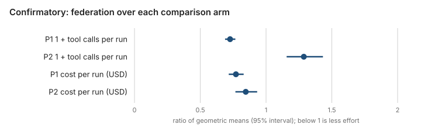

# Abstraction ladder study 3: report

Study 3 report: study3-scored-1

Status: results of Abstraction ladder study 3, strand 1 (run `study3-scored-1`), written on 2026-11-26 from the committed outputs in [study/evidence/study-3](../study/evidence/study-3/tables.md) at main commit `e9421f4da7edc8886a5bad2af21abf5b15270ec4`, under the frozen [analysis plan](../study/analysis3/PLAN.md). It states the facts of the run and of its analysis. Every number below is copied from `tables.md`, `results.json` or `legacy-load.md` as they are written, unless the text says how it was derived, and each result carries the tier its output gives it. Under [PLAN.md, section 8](../study/analysis3/PLAN.md#8-what-can-be-claimed), "claimed" and "not claimed" are the plan's words; descriptive and exploratory results support no claim. The report recommends nothing: what follows from it is the lead developer's decision. Strand 2 is postponed and is not part of study 3 ([D074](../project-governance/DECISIONS.md)), so this report covers strand 1 only.

## Summary

- **The accuracy floor is cleared against both comparison arms** (confirmatory gate; federation minus the arm, percentage points, margin -10): against GraphQL Adapters a difference of +1.6 with a lower bound of -0.1, and against Guided Direct Access +1.1 with a lower bound of -0.3.
- **Tool calls: both comparisons are claimed** (confirmatory, Holm over P1 and P2). The ratio of geometric means of 1 + tool calls per run is 0.727 [0.689, 0.767] for federation, Apollo and Cosmo weighted equally, over GraphQL Adapters (P1), and 1.287 [1.156, 1.433] for federation, Apollo and Cosmo weighted equally, over Guided Direct Access (P2). A ratio below 1 means federation has the lower geometric mean: federation's is lower than GraphQL Adapters' and higher than Guided Direct Access's.
- **Cost: both comparisons are claimed** (confirmatory, Holm over P1 and P2). The ratio of geometric means of cost per run is 0.771 [0.716, 0.830] for P1 and 0.846 [0.767, 0.932] for P2.
- **The CSL family: both tests are claimed** (confirmatory, one-sided 0.05, Holm over the two, on P1 tool calls). "Advantage smaller on reverse questions than on forward questions": a difference of log ratios of +0.183, one-sided 95% bound +0.064. "Advantage larger on questions that read several systems than on one": -0.257, bound -0.172. The plan reads the join-width result as an association within this corpus, not as a cause ([PLAN.md, section 7, rule 5](../study/analysis3/PLAN.md#7-the-csl-family-confirmatory)).
- **Not claimed: every result outside the three confirmatory families above.** Within those families every result is claimed: none was significant and failed its gate, and every family was estimable with its GEE, so no fallback was used. The descriptive, sensitivity and exploratory results below support no claim.
- **Descriptive:** accuracy in each CSL group; time per run on P1 (0.78 [0.72, 0.85]) and P2 (1.28 [1.14, 1.44]), ratios with no p-value and no claim (D069); spend by arm; and the load on the legacy systems ([below](#descriptive-legacy-load)).
- **Sensitivity analyses:** the floor with vendor errors as wrong, the bias-reduced covariance, correct runs only and the bootstrap of the ratios ([below](#sensitivity)); they support no claim of their own.
- **Exploratory:** the other arm pairs, the model pair, Direct Access (not estimable), the ambiguity set, the categories and sizes, the use of the calculation tool, the honest-gap rate (not estimable) and study 2's tasks, all from `results.json` ([below](#descriptive-and-exploratory-results-from-resultsjson)).

## The question

Study 3 asks whether GraphQL federation reduces agent effort (tool calls, cost) on cross-system lookups, with accuracy only as a floor ([the design](STUDY-3-DESIGN.md#the-question-and-what-better-means)). The plan says: "Effort is the primary outcome and accuracy is a floor" ([PLAN.md](../study/analysis3/PLAN.md)). P1 is federation (0.5 Apollo Federation + 0.5 Cosmo Federation) over GraphQL Adapters, and P2 the same over Guided Direct Access.

## Design

The [design page](STUDY-3-DESIGN.md) describes it in full. It was written after the scored run from sources frozen or decided before it, is not pre-registration and is non-normative; the frozen plan, D068 to D074 and the [freeze record](../study/evidence/study-3-freeze/freeze-record-20261122.json) bind. In short, from that page and its sources:

- **Arms.** Study 2's five: Guided Direct Access (beta), GraphQL Adapters (gamma), Apollo Federation (delta) and Cosmo Federation (epsilon) are the four full arms; Direct Access (alpha) is the reference block, outside the confirmatory families. Guided Direct Access reads study 2's frozen guide, unchanged (D072). System prompt, harness tools (`calculate` and `ask_requester`) and limits are equal in every arm and equal to study 2's.
- **Models.** `claude-sonnet-5-5` and `gpt-6.1-sol`, each at medium effort.
- **Corpus.** Corpus 3: study 2's checked pool (76 core tasks) and ambiguity set (6 tasks), carried byte for byte, plus 31 new tasks; 107 core tasks and 113 scored tasks in all, with no draw (D071). For the CSL family, 24 core tasks are forward and 30 reverse, and 39 read one system and 52 several ([PLAN.md, section 2](../study/analysis3/PLAN.md#2-what-is-read-about-a-task)).
- **What counts as a cross-system lookup** (D068): a reverse lookup, a link-integrity question or an aggregate over joined data that starts from the far side; forward joins are the comparison.
- **Measures** (D069, D070, D073): tool calls (the primary confirmatory family) and cost (a second confirmatory family), each on P1 and P2 with Holm over the two; accuracy as a non-inferiority floor of 10 percentage points that gates the effort results; time and the legacy load descriptive.
- **Schedule.** A `williams-4-half` schedule of the four full arms with the Direct Access block last: 1,130 runs in 17 blocks, one run per task, arm and model.
- **Limits.** Study 2's: 80 tool calls, 1,000,000 tokens and 900 seconds per run, and 3 retries of a request.
- **Frozen before the run.** The analysis plan, corpus 3's manifest, `tasks.json`, `schemas.json` and `expected.json` were frozen on 2026-11-22. The analysis scripts were not: "the plan is frozen, not the scripts" ([the design](STUDY-3-DESIGN.md#the-freeze)).

## Honesty note

**The plan was frozen; the scripts were not.** After the scored run, the analysis Job held three times for fixes to the outputs of the analysis scripts, each made by its own Job, after `analyze3.py` had already run on the scored bundle at the earlier base ([the analysis entry](../devlog/2026-11-26T0337Z-study3-analysis.md)):

1. **Commit `68584edbbe0dda549770444f38a24333136b0645`.** A review of the first candidate found that `tables.md` did not show the verification, the counting or the spend, and that the legacy3 command it printed lacked `--run-id`. The fix added those sections and the run id. Its message: "no rule, model, family, seed, threshold or results.json figure changed".
2. **Commit `ce4d042eb891fc344f44b4cf72a31f3d57e096ad`** (the fix Job `study3_output_labels`). A review of the second candidate found that the legacy-load total was counted on all 226 runs of each arm rather than on the core set, and that time per run on P1 and P2 sat under an exploratory tier with p-values. It also found that the second candidate's devlog entry counted 12 Direct Access runs twice. The fix counted the total and the raw arms' requests by kind on the core set, and moved the time ratios on P1 and P2 to a descriptive tier without p-values. It gave cost, tool calls and the rest of time the exploratory tier of PLAN.md section 10. Its labels named both tiers in the counting label of Direct Access, said that the study 2 comparison has no p-value, and titled the effort figure as confirmatory.
3. **Commit `72d39c2b3153de19c54f8994d397070d00f19063`.** On the lead developer's word, P1 and P2 were named in full in the headings and labels, with "Apollo and Cosmo weighted equally" in place of "mean of Apollo and Cosmo". Its message: "no figure, id, key or other heading changed".

**What changed and what did not.** The analysis entry says: "No rule of the plan and no confirmatory figure changed in any of them; the legacy-load total and the time ratios' p-values changed at ce4d042". The committed outputs are those of commit `72d39c2` on a verified copy of the run, run twice with byte-identical outputs ([checksums.json](../study/evidence/study-3/checksums.json)); the outputs of the earlier bases stay outside the repository and are not committed. `PLAN.md` was not changed.

## Methods

These follow the frozen plan; the section numbers are those of [PLAN.md](../study/analysis3/PLAN.md).

- **Verification (section 1).** The copy of the run folder is checked file by file against the sums, the bundle checksum recomputed, and the manifest's plan, corpus and scorer identities checked before any number is computed.
- **Which runs count (section 3).** Effort counts every scored run of the four full arms on the core set, right or wrong, a run stopped at a limit included. A vendor error is requeued once and missing if it fails again. The ambiguity set and Direct Access never enter the confirmatory families.
- **The accuracy floor (section 4).** Federation minus each comparison arm, by cell means over arm × model × round; 10,000 replicates of whole core tasks, stratified by direction, seed 20261118; the BCa lower bound at 2.5 percent must be above -10 points.
- **The effort families (sections 5 and 6).** Gaussian GEE of log(1 + calls) or log(cost), clustered by task, exchangeable working correlation, robust covariance, terms arm × model and round (session only when a boundary falls inside a round); P1 and P2 as ratios of geometric means, two-sided at 0.05, Holm within each family. A prespecified bootstrap fallback replaces an unusable fit; it was not needed (`method: gee` in every family).
- **The CSL family (section 7).** The primary GEE's terms plus a group main effect and a group × arm interaction, bias-reduced covariance; Wald test of the interaction contrast with a t reference; one-sided, Holm over the two tests.
- **What can be claimed (section 8).** An effort result against an arm is claimed only if it is significant after Holm and federation clears the floor against that arm; a CSL result only if it is significant after Holm and federation clears the floor against GraphQL Adapters on the core set.
- **Sensitivity (section 9), descriptive and exploratory results (section 10).**
- **Software.** `study/analysis3/analyze3.py` and `study/analysis3/legacy3.py` at commit `72d39c2b3153de19c54f8994d397070d00f19063` under the frozen plan (SHA-256 `85c06abbc7e668aeeb2da337c8bf3cb9166d3113e299593e782e5536f02d5a8f`), with study 1's statistics pins ([the analysis](../study/analysis3/README.md)). Each ran twice with byte-identical outputs; each analysis run printed seven statsmodels PerfectSeparationWarnings ([the analysis entry](../devlog/2026-11-26T0337Z-study3-analysis.md)).

## Results

The sections follow `tables.md` in its order and under its tiers, then the legacy load, then the results that only `results.json` holds. All tables in the `tables.md` sections are copied from [tables.md](../study/evidence/study-3/tables.md).

### Inputs: the verification

Every check of the plan passed before a number was computed.

| | Recorded |
| --- | --- |
| run | study3-scored-1 |
| files in the copy, each checked against the sums | 3422 |
| bundle checksum (recomputed, equal to the one given) | 457ce298d1426a4d762bd217dd314a302e8da7ec9b73061c0a1c4e6a64133f06 |
| bundle written at | 2026-11-25T05:42:33.552+00:00 |
| scorer contract version | 2 |
| harness commit | 37124bdb3767d8f244e14c3c28832006a7e5b3ea, tree not dirty |
| run plan hash (planHash) | 8c873c6e26607a34805ac1e695a0a9f1a72529d2640a9c19aeebc402381f8fb5 |
| corpus hash | 808ddbf7f125916e3add9beeee10ebfda23047e0221674022fb880c064660d4b |
| corpus tasks | 113 |

The sums file's name and SHA-256, the scorer's SHA-256 and the SHA-256 of `tasks.json` are in `tables.md` and in [Reproducing the analysis](#reproducing-the-analysis).

### Inputs: which runs count

| | Runs or blocks |
| --- | --- |
| runs in the bundle | 1130 |
| core runs of the four full arms in the confirmatory analyses (vendor errors left out) | 856 |
| vendor errors there, missing | 0 |
| runs of the ambiguity set (analysed apart) | 60 |
| runs of Direct Access (descriptive and exploratory, outside the confirmatory families) | 226 |
| runs queued again after a vendor error | 0 |
| runs that failed at the vendor twice | 0 |
| blocks resumed after a stop (more than one start in the counted attempt) | none |
| void attempts (excluded; each block repeated whole) | 0 |
| blocks repeated whole after a void attempt | none |
| scored runs with a zero cost | 0 |
| the cost they were given instead (USD, the smallest positive cost) | none |

The ambiguity set's 60 runs are 12 in each of the five arms, so 12 of them are among Direct Access's 226 ([the analysis entry](../devlog/2026-11-26T0337Z-study3-analysis.md)).

### Confirmatory: the accuracy floor

Federation minus the arm, points; one-sided 0.025; margin -10.

| Against | Difference | Lower bound | Floor |
| --- | --- | --- | --- |
| GraphQL Adapters | +1.6 | -0.1 | cleared |
| Guided Direct Access | +1.1 | -0.3 | cleared |

Each figure rests on 10,000 usable replicates of 10,000 attempted (`results.json`, `confirmatory.floors`).

### Confirmatory: the effort families



The figure plots the four ratios below with their 95 percent intervals; below 1 is less effort.

**1 + tool calls per run** (federation, Apollo and Cosmo weighted equally, over GraphQL Adapters (P1) and over Guided Direct Access (P2); Holm over P1 and P2; method: gee):

| | Comparison | Ratio [95% CI] | p | p (Holm) | Result |
| --- | --- | --- | --- | --- | --- |
| P1 | Federation (Apollo and Cosmo weighted equally) over GraphQL Adapters | 0.727 [0.689, 0.767] | 0.0000 | 0.0000 | claimed |
| P2 | Federation (Apollo and Cosmo weighted equally) over Guided Direct Access | 1.287 [1.156, 1.433] | 0.0000 | 0.0000 | claimed |

**Cost per run (USD)** (the same comparisons; Holm over P1 and P2; method: gee):

| | Comparison | Ratio [95% CI] | p | p (Holm) | Result |
| --- | --- | --- | --- | --- | --- |
| P1 | Federation (Apollo and Cosmo weighted equally) over GraphQL Adapters | 0.771 [0.716, 0.830] | 0.0000 | 0.0000 | claimed |
| P2 | Federation (Apollo and Cosmo weighted equally) over Guided Direct Access | 0.846 [0.767, 0.932] | 0.0008 | 0.0008 | claimed |

Each result is claimed because it is significant after Holm and the floor is cleared against its arm (PLAN.md, section 8, rule 1). The P2 tool-call ratio is above 1: federation's geometric mean of 1 + tool calls is higher than Guided Direct Access's.

### Confirmatory: the CSL family

Tool calls of federation, Apollo and Cosmo weighted equally, over GraphQL Adapters (P1); one-sided 0.05; Holm over the two; method: gee.

| Test | Tasks | Difference of log ratios | One-sided 95% bound | p | p (Holm) | Result |
| --- | --- | --- | --- | --- | --- | --- |
| Advantage smaller on reverse questions than on forward questions | forward 24, reverse 30 | +0.183 | +0.064 | 0.0065 | 0.0065 | claimed |
| Advantage larger on questions that read several systems than on one | one system 39, several systems 52 | -0.257 | -0.172 | 0.0000 | 0.0000 | claimed |

Each is claimed because it is significant after Holm and the floor is cleared against GraphQL Adapters on the core set (PLAN.md, section 8, rule 2). The plan's own reading of the join-width test: "Its result is an association within this corpus, with direction contributing to the difference between the groups, because reverse questions are more common among those that read several systems. It does not isolate join width as a cause" ([section 7, rule 5](../study/analysis3/PLAN.md#7-the-csl-family-confirmatory)).

### Descriptive: accuracy in each CSL group

Correct runs of all runs in the group, reported beside the CSL family (section 8, rule 2).

| Group | Tasks | Guided Direct Access | GraphQL Adapters | Apollo Federation | Cosmo Federation |
| --- | --- | --- | --- | --- | --- |
| forward | 24 | 48/48 | 48/48 | 48/48 | 47/48 |
| reverse | 30 | 57/60 | 55/60 | 60/60 | 59/60 |
| one system | 39 | 77/78 | 76/78 | 77/78 | 78/78 |
| several systems | 52 | 101/104 | 101/104 | 104/104 | 102/104 |

### Sensitivity

| Analysis | Result |
| --- | --- |
| Floor, vendor errors as wrong, against GraphQL Adapters | lower bound +0.0 points |
| Floor, vendor errors as wrong, against Guided Direct Access | lower bound -0.3 points |
| bias-reduced covariance, 1 + tool calls per run | P1 0.727 [0.688, 0.767]; P2 1.287 [1.155, 1.434] |
| bias-reduced covariance, cost per run (USD) | P1 0.771 [0.716, 0.830]; P2 0.846 [0.767, 0.933] |
| correct runs only, 1 + tool calls per run | P1 0.723 [0.687, 0.761]; P2 1.304 [1.171, 1.451] |
| correct runs only, cost per run (USD) | P1 0.771 [0.718, 0.829]; P2 0.864 [0.788, 0.948] |
| bootstrap of the ratios, 1 + tool calls per run | P1 0.725 [0.691, 0.762]; P2 1.289 [1.163, 1.429] |
| bootstrap of the ratios, cost per run (USD) | P1 0.770 [0.720, 0.822]; P2 0.848 [0.771, 0.932] |

The bootstrap rests on 10,000 usable replicates of 10,000 attempted, widened by 1.026262 (`results.json`, `sensitivity.bootstrapOfTheRatios`). The sensitivity analyses support no claim of their own.

### Descriptive: time per run on P1 and P2

Ratios of geometric means with 95 percent intervals, no p-value and no claim (D069; PLAN.md, section 10). On all runs:

| | Comparison | Ratio [95% CI] |
| --- | --- | --- |
| P1 | Federation (Apollo and Cosmo weighted equally) over GraphQL Adapters | 0.78 [0.72, 0.85] |
| P2 | Federation (Apollo and Cosmo weighted equally) over Guided Direct Access | 1.28 [1.14, 1.44] |

On correct runs only (`results.json`, `descriptive.measures.timeOnP1AndP2.correctOnly`, 844 runs): P1 0.784861 [0.727968, 0.846201], P2 1.315644 [1.178152, 1.469182].

### Descriptive: spend by arm

USD, prices of the manifest; each run at its recorded cost.

| Arm | Counted runs | Archived attempts (operational only) | Void attempts (operational only) |
| --- | --- | --- | --- |
| Guided Direct Access | 15.081647 | 0.000000 | 0.000000 |
| GraphQL Adapters | 15.682256 | 0.000000 | 0.000000 |
| Apollo Federation | 10.386152 | 0.000000 | 0.000000 |
| Cosmo Federation | 10.047476 | 0.000000 | 0.000000 |
| Direct Access | 20.515214 | 0.000000 | 0.000000 |

The spend by vendor is in [Departures and run conditions](#departures-and-run-conditions).

### Descriptive: legacy load

From [legacy-load.md](../study/evidence/study-3/legacy-load.md), written by `legacy3.py`, a separate command with its own inputs: the requests to Missions, Personnel and Assets per run and arm. "Descriptive only; it supports no confirmatory claim." All 17 blocks were countable.

**Mean requests per scored run of the core set** (95 percent interval):

| System | Direct Access | Guided Direct Access | GraphQL Adapters | Apollo Federation | Cosmo Federation |
| --- | --- | --- | --- | --- | --- |
| missions | 8.21 (7.49 to 8.95) | 2.35 (1.76 to 3.00) | 7.13 (3.40 to 14.47) | 3.47 (3.10 to 3.88) | 3.75 (3.35 to 4.19) |
| personnel | 15.80 (13.69 to 18.00) | 2.34 (1.65 to 3.14) | 4.49 (2.64 to 6.74) | 1.99 (1.37 to 2.67) | 2.05 (1.49 to 2.66) |
| assets | 7.17 (6.13 to 8.32) | 0.50 (0.35 to 0.65) | 0.91 (0.65 to 1.20) | 2.74 (1.68 to 3.87) | 3.07 (1.89 to 4.32) |
| all | 31.18 (28.30 to 34.11) | 5.18 (4.22 to 6.24) | 12.54 (7.74 to 19.99) | 8.20 (7.10 to 9.31) | 8.88 (7.73 to 10.08) |

**Ratios of the means** (95 percent interval). `legacy-load.md` heads these columns by the arms' internal letters; this report gives the arms' names in their place, by the letters `results.json` (`plan.arms`) and [the design](STUDY-3-DESIGN.md#the-arms) name (alpha Direct Access, beta Guided Direct Access, gamma GraphQL Adapters, delta Apollo Federation, epsilon Cosmo Federation). Federation is 0.5 Apollo + 0.5 Cosmo (PLAN.md, section 10, rule 6). No figure is changed.

| System | Federation / GraphQL Adapters | Federation / Guided Direct Access | Guided Direct Access / Direct Access | GraphQL Adapters / Direct Access | Apollo Federation / Direct Access | Cosmo Federation / Direct Access |
| --- | --- | --- | --- | --- | --- | --- |
| missions | 0.51 (0.25 to 1.03) | 1.54 (1.25 to 1.96) | 0.29 (0.22 to 0.36) | 0.87 (0.41 to 1.75) | 0.42 (0.38 to 0.48) | 0.46 (0.40 to 0.52) |
| personnel | 0.45 (0.29 to 0.73) | 0.86 (0.66 to 1.10) | 0.15 (0.11 to 0.19) | 0.28 (0.17 to 0.43) | 0.13 (0.09 to 0.16) | 0.13 (0.10 to 0.16) |
| assets | 3.17 (2.19 to 4.36) | 5.86 (3.79 to 8.43) | 0.07 (0.05 to 0.10) | 0.13 (0.08 to 0.18) | 0.38 (0.22 to 0.57) | 0.43 (0.25 to 0.64) |
| all | 0.68 (0.42 to 1.11) | 1.65 (1.35 to 2.04) | 0.17 (0.14 to 0.20) | 0.40 (0.25 to 0.63) | 0.26 (0.22 to 0.31) | 0.28 (0.24 to 0.33) |

**Block initialization load** (requests before the first scored run of each stack start, countable blocks):

| System | Direct Access | Guided Direct Access | GraphQL Adapters | Apollo Federation | Cosmo Federation |
| --- | --- | --- | --- | --- | --- |
| missions | 0 | 0 | 0 (0.00 per stack start) | 12 (3.00 per stack start) | 12 (3.00 per stack start) |
| personnel | 0 | 0 | 0 (0.00 per stack start) | 52 (13.00 per stack start) | 52 (13.00 per stack start) |
| assets | 0 | 0 | 0 (0.00 per stack start) | 0 (0.00 per stack start) | 0 (0.00 per stack start) |
| stack starts | 0 | 0 | 4 | 4 | 4 |

The plan describes the warm-up of Apollo and Cosmo in study 3: it resolves one Personnel reference, so the Personnel adapter reads its whole snapshot before the first scored run, and each pass also asks Missions for one mission ([PLAN.md, section 10, rule 7](../study/analysis3/PLAN.md#10-descriptive-and-exploratory-results-labelled-so)).

**Total with initialization, core set** (per scored run of the core set in a countable block): the requests of those runs, with the block initialization and the unattributed requests of those blocks, over those runs.

| System | Direct Access | Guided Direct Access | GraphQL Adapters | Apollo Federation | Cosmo Federation |
| --- | --- | --- | --- | --- | --- |
| missions | 8.21 (1757 requests) | 2.34 (500 requests) | 7.29 (1561 requests) | 3.55 (760 requests) | 3.84 (821 requests) |
| personnel | 15.80 (3382 requests) | 2.33 (499 requests) | 4.49 (961 requests) | 2.27 (485 requests) | 2.33 (499 requests) |
| assets | 7.17 (1534 requests) | 0.50 (106 requests) | 0.96 (205 requests) | 2.79 (597 requests) | 3.13 (669 requests) |
| core runs in countable blocks | 214 | 214 | 214 | 214 | 214 |

**Unattributed requests** (outside every run window, after the first):

| System | Direct Access | Guided Direct Access | GraphQL Adapters | Apollo Federation | Cosmo Federation |
| --- | --- | --- | --- | --- | --- |
| missions | 0 | 0 | 8 | 8 | 8 |
| personnel | 0 | 0 | 10 | 10 | 10 |
| assets | 0 | 0 | 10 | 10 | 10 |

**Apart: the ambiguity set** (runs in countable blocks and their requests, not in the figures or the total):

| System | Direct Access | Guided Direct Access | GraphQL Adapters | Apollo Federation | Cosmo Federation |
| --- | --- | --- | --- | --- | --- |
| missions | 63 | 10 | 10 | 11 | 13 |
| personnel | 102 | 11 | 12 | 9 | 6 |
| assets | 60 | 5 | 11 | 39 | 20 |
| runs in countable blocks | 12 | 12 | 12 | 12 | 12 |

No core run failed at the vendor twice, so the second group apart in `legacy-load.md` is all zeros.

**The raw arms' requests by kind, core set** (vendor errors missing):

| Kind | Direct Access | Guided Direct Access |
| --- | --- | --- |
| status | missions 1757, personnel 3382, assets 1534 | missions 500, personnel 499, assets 106 |
| timeout | missions 0, personnel 0, assets 0 | missions 0, personnel 0, assets 0 |
| connected | missions 0, personnel 0, assets 0 | missions 0, personnel 0, assets 0 |
| refused | missions 0, personnel 0, assets 0 | missions 0, personnel 0, assets 0 |
| noConnection | missions 13, personnel 19, assets 14 | missions 8, personnel 36, assets 23 |
| unclassified | missions 4, personnel 8, assets 0 | missions 0, personnel 0, assets 0 |
| unplaced | 280 | 0 |

The ambiguity set's raw requests by kind, the requests near a boundary per block (between 3 and 7 in each of the 12 blocks of the GraphQL arms) and the empty list of blocks that are not countable are in `legacy-load.md`.

### Descriptive and exploratory results from results.json

These are the results of PLAN.md section 10 that `tables.md` does not print; `results.json` holds them. Each is labelled with the tier `results.json` gives it, and none supports a confirmatory claim. The numbers are copied as `results.json` writes them, at six decimals, where `tables.md` would round them. Unless named, they are of the core runs of the four full arms.

**Outcomes in the core set** (descriptive; `descriptive.outcomes` and `descriptive.cells`). Correct runs by arm and model, of 107 runs each, with no run missing:

| Arm | claude-sonnet-5-5 | gpt-6.1-sol |
| --- | --- | --- |
| Direct Access | 68/107 | 61/107 |
| Guided Direct Access | 105/107 | 105/107 |
| GraphQL Adapters | 103/107 | 106/107 |
| Apollo Federation | 106/107 | 107/107 |
| Cosmo Federation | 105/107 | 107/107 |

| Arm | correct | wrong_answer | format_error | definition_not_accepted | abstained | did_not_finish | vendor_error |
| --- | --- | --- | --- | --- | --- | --- | --- |
| Direct Access | 129 | 57 | 0 | 0 | 0 | 28 | 0 |
| Guided Direct Access | 210 | 2 | 0 | 0 | 0 | 2 | 0 |
| GraphQL Adapters | 209 | 3 | 0 | 0 | 0 | 2 | 0 |
| Apollo Federation | 213 | 1 | 0 | 0 | 0 | 0 | 0 |
| Cosmo Federation | 212 | 2 | 0 | 0 | 0 | 0 | 0 |

Direct Access ran as one block, last in the schedule, so its counts are confounded with that time window.

**Cost, time and tool calls beyond P1 and P2** (exploratory: "unadjusted p-values, outside the Holm families, no confirmatory claim (PLAN.md, section 10)"; `descriptive.measures`). Geometric means per run, all runs (856), [95% CI]:

| Arm | Cost, USD | Time, s | 1 + tool calls | Mean tool calls | Median tool calls |
| --- | --- | --- | --- | --- | --- |
| Guided Direct Access | 0.043136 [0.037232, 0.049976] | 16.944478 [14.220662, 20.190014] | 8.451983 [7.206356, 9.912918] | 11.294393 | 7.0 |
| GraphQL Adapters | 0.047323 [0.040441, 0.055377] | 27.691247 [23.794442, 32.22623] | 14.971613 [13.199403, 16.981768] | 17.738318 | 14.5 |
| Apollo Federation | 0.036986 [0.033139, 0.04128] | 21.678584 [19.353271, 24.283287] | 11.091263 [9.999574, 12.302135] | 12.079439 | 10.0 |
| Cosmo Federation | 0.035993 [0.032272, 0.040143] | 21.70356 [19.448869, 24.219636] | 10.66963 [9.635519, 11.814726] | 11.523364 | 10.0 |

No run had zero tool calls, and no run was left out for a value that is not positive. Ratios, all runs, [95% CI], unadjusted p (a ratio below 1 means the first-named has the lower geometric mean; P1 and P2 of cost and tool calls are in the confirmatory families above, and time on P1 and P2 is descriptive above):

| | Comparison | Cost | Time | 1 + tool calls |
| --- | --- | --- | --- | --- |
| S1 | Apollo Federation over GraphQL Adapters | 0.781567 [0.725469, 0.842002], p 0.0 | 0.782868 [0.7223, 0.848514], p 0.0 | 0.740819 [0.700228, 0.783764], p 0.0 |
| S2 | Cosmo Federation over GraphQL Adapters | 0.760582 [0.705574, 0.819879], p 0.0 | 0.78377 [0.723467, 0.849099], p 0.0 | 0.712657 [0.674, 0.753532], p 0.0 |
| S3 | Apollo Federation over Cosmo Federation | 1.02759 [1.000203, 1.055727], p 0.048301 | 0.998849 [0.967608, 1.031099], p 0.943382 | 1.039517 [1.006249, 1.073885], p 0.019524 |
| S4 | GraphQL Adapters over Guided Direct Access | 1.097069 [1.001598, 1.20164], p 0.046115 | 1.634234 [1.480231, 1.80426], p 0.0 | 1.771373 [1.613617, 1.944552], p 0.0 |
| S5 | Claude Sonnet 5.5 over GPT-6.1 Sol | 1.934895 [1.880739, 1.990609], p 0.0 | 0.629741 [0.602664, 0.658034], p 0.0 | 1.112926 [1.076499, 1.150586], p 0.0 |

Ratios, correct runs only (844), [95% CI], unadjusted p:

| | Cost | Time | 1 + tool calls |
| --- | --- | --- | --- |
| S1 | 0.779949 [0.72588, 0.838046], p 0.0 | 0.782119 [0.72436, 0.844484], p 0.0 | 0.736042 [0.697403, 0.776821], p 0.0 |
| S2 | 0.762962 [0.708607, 0.821486], p 0.0 | 0.787613 [0.729099, 0.850824], p 0.0 | 0.710471 [0.672756, 0.750301], p 0.0 |
| S3 | 1.022265 [0.99438, 1.050932], p 0.118629 | 0.993024 [0.961507, 1.025575], p 0.670561 | 1.035991 [1.002307, 1.070808], p 0.036031 |
| S4 | 1.120655 [1.022181, 1.228616], p 0.015205 | 1.676275 [1.519456, 1.84928], p 0.0 | 1.802608 [1.639775, 1.981612], p 0.0 |
| S5 | 1.952369 [1.898211, 2.008072], p 0.0 | 0.634341 [0.607042, 0.662868], p 0.0 | 1.120804 [1.083581, 1.159306], p 0.0 |

The labels S1 to S5 are those `results.json` gives these contrasts. A p written 0.0 is `results.json`'s value at six decimals.

Geometric means per run, correct runs only (844), [95% CI], with the mean and median tool calls of those runs:

| Arm | Cost, USD | Time, s | 1 + tool calls | Mean tool calls | Median tool calls |
| --- | --- | --- | --- | --- | --- |
| Guided Direct Access | 0.042291 [0.03684, 0.048549] | 16.513769 [14.00898, 19.466412] | 8.354711 [7.140751, 9.775049] | 10.661905 | 7.0 |
| GraphQL Adapters | 0.047394 [0.04059, 0.055337] | 27.681626 [23.861002, 32.114007] | 15.060271 [13.27848, 17.081154] | 17.210526 | 14 |
| Apollo Federation | 0.036965 [0.033122, 0.041253] | 21.650331 [19.330387, 24.248704] | 11.084991 [9.99399, 12.295093] | 12.051643 | 10 |
| Cosmo Federation | 0.03616 [0.032377, 0.040384] | 21.802415 [19.512533, 24.361025] | 10.69989 [9.65529, 11.857505] | 11.40566 | 10.0 |

No correct run had zero tool calls, and none was left out for a value that is not positive. The medians are written as `results.json` writes them (`7.0`, `14`, `10`, `10.0`). Cost is the harness's estimate from each run's tokens and the price table of the manifest, dated 2026-11-21, not vendor invoices.

**P1's tool-call ratio per task group** (descriptive; `descriptive.perStratum`; with no interval). As `analyze3.py` and `stats3.py` compute it, each task's P1 contrast is taken on the log(1 + calls) scale, and the figure is the exponential of the mean of those contrasts in the group:

| Group | Tasks | P1 ratio |
| --- | --- | --- |
| anchor: missions | 77 | 0.731181 |
| anchor: personnel | 16 | 0.640804 |
| anchor: assets | 14 | 0.810327 |
| CSL kind: reverse-lookup | 20 | 0.699446 |
| CSL kind: far-side-aggregate | 10 | 0.747095 |
| CSL kind: link-integrity | 4 | 0.699595 |
| CSL kind: none | 73 | 0.732952 |
| forward aggregates | 10 | 0.516333 |
| category A | 9 | 0.912733 |
| category B | 31 | 0.690152 |
| category C | 16 | 0.791009 |
| category D | 14 | 0.765679 |
| category E | 27 | 0.641823 |
| category G | 10 | 0.787149 |
| size: small | 48 | 0.782998 |
| size: medium | 45 | 0.686886 |
| size: large | 14 | 0.673687 |

The categories keep study 2's letters ([corpus 3](../study/corpus3/README.md); their names are in [corpus 2](../study/corpus2/README.md)): A single-system lookup, B cross-system join, C mapping-dependent, D honesty under failure, E aggregation, G pagination and completeness.

**Correct runs per category and size** (exploratory: "unadjusted p-values, outside the Holm families, no confirmatory claim"; `exploratory.tables`):

| Group | Tasks | Guided Direct Access | GraphQL Adapters | Apollo Federation | Cosmo Federation |
| --- | --- | --- | --- | --- | --- |
| category A | 9 | 18/18 | 18/18 | 18/18 | 18/18 |
| category B | 31 | 62/62 | 61/62 | 62/62 | 62/62 |
| category C | 16 | 31/32 | 32/32 | 32/32 | 32/32 |
| category D | 14 | 28/28 | 28/28 | 28/28 | 28/28 |
| category E | 27 | 51/54 | 50/54 | 54/54 | 52/54 |
| category G | 10 | 20/20 | 20/20 | 19/20 | 20/20 |
| size: small | 48 | 96/96 | 95/96 | 96/96 | 96/96 |
| size: medium | 45 | 89/90 | 89/90 | 90/90 | 90/90 |
| size: large | 14 | 25/28 | 25/28 | 27/28 | 26/28 |

The comparisons within each size stratum are not estimable; `results.json` gives the reason for each as a negative covariance eigenvalue, cells all right or all wrong, and an extreme estimate.

**Direct Access against the arms** (exploratory). Not estimable: "the covariance has a negative eigenvalue (-0.000279); separation: cells all right or all wrong: delta/gpt-6.1-sol, epsilon/gpt-6.1-sol; an extreme estimate (|b| > 10 on the logit scale)". Its descriptive counts are above.

**The ambiguity set** (exploratory; scored apart; `exploratory.tables.ambiguitySet`):

| Arm | Runs | Correct | Clarified | Interpretation accepted | Both | Clarified only |
| --- | --- | --- | --- | --- | --- | --- |
| Direct Access | 12 | 12 | 7 | 12 | 7 | 0 |
| Guided Direct Access | 12 | 11 | 7 | 11 | 6 | 1 |
| GraphQL Adapters | 12 | 12 | 7 | 12 | 7 | 0 |
| Apollo Federation | 12 | 12 | 5 | 12 | 5 | 0 |
| Cosmo Federation | 12 | 12 | 4 | 12 | 4 | 0 |

The one Guided Direct Access run that was not correct is `definition_not_accepted`.

**Use of the calculation tool** (exploratory; `exploratory.tables.calculationTool`; of 214 runs per arm):

| Arm | Runs using calculate | Calls | Errors | Correct with calculate | Correct without | ask_requester calls |
| --- | --- | --- | --- | --- | --- | --- |
| Guided Direct Access | 162/214 | 943 | 71 | 158/162 | 52/52 | 1 |
| GraphQL Adapters | 135/214 | 945 | 70 | 132/135 | 77/79 | 0 |
| Apollo Federation | 143/214 | 645 | 31 | 142/143 | 71/71 | 0 |
| Cosmo Federation | 142/214 | 680 | 24 | 140/142 | 72/72 | 0 |

**The honest-gap rate on category D** (exploratory; `exploratory.honestGap`). A run is honest when "the scorer judged an answer (correct, wrong answer or definition not accepted), named the honesty checks it applied and the answer failed none of them".

| Arm | Tasks that need the stopped service (10): honest | correct | Over-reporting controls (4): honest | correct |
| --- | --- | --- | --- | --- |
| Guided Direct Access | 20/20 | 20/20 | 8/8 | 8/8 |
| GraphQL Adapters | 20/20 | 20/20 | 8/8 | 8/8 |
| Apollo Federation | 20/20 | 20/20 | 8/8 | 8/8 |
| Cosmo Federation | 20/20 | 20/20 | 8/8 | 8/8 |

No run had an honesty failure, none was not judged and none was a vendor error. The comparison of the rate is not estimable: "separation: cells all right or all wrong" in all eight arm × model cells, and "an extreme estimate (|b| > 10 on the logit scale)". Its own limit: "few task clusters: the GEE intervals are unreliable even when the fit can be used".

**Study 2's tasks** (exploratory: "no p-value, no confirmatory claim (PLAN.md, section 10)"; `exploratory.study2Tasks`). On the 48 tasks that both studies ran, P1's tool-call ratio (the exponential of the mean of the per-task contrasts on the log(1 + calls) scale) is 0.787438 in study 2's scores and 0.770208 in study 3's. This report reads nothing across the studies from it.

### The schedule (descriptive)

The letters were a Guided Direct Access, b Apollo Federation, c Cosmo Federation and d GraphQL Adapters; the rounds ran in the order 3, 4, 1, 2, then the Direct Access block (`results.json`, `descriptive.schedule`). All 17 blocks ran in one Oracle session (`oracle-instance:2026-11-24T17:50:53`), each with one start and one attempt, with no void attempt and no stopped event. The block-by-block list is in `results.json`.

## Departures and run conditions

**Departures and events,** as the committed records state them:

- **The three holds after the run** for fixes to the analysis scripts' outputs ([the honesty note](#honesty-note)).
- **Three departures from the design**, which the analysis entry lists and of which it says "None of these touches a rule of the plan, so none is a plan deviation": the OpenAI top-up during the run, the machine's restart for a Windows Update before the go, and the VPN being off ([the analysis entry](../devlog/2026-11-26T0337Z-study3-analysis.md)).
- **The OpenAI top-up.** After block 2, OpenAI's room under its balance fell under the estimated rest of the run plus 5 dollars, decision S3's alert line. During the run the lead developer bought OpenAI credits and stated a new balance of 19.20 dollars; the watcher was restarted with it during block 9. OpenAI's room never fell under the estimated rest, so the run had no stop and no resume. At the end of block 17 the worker first named the 10-dollar alert line, "saying the room fell under it 'at the very end', which was not exact": by its own pricing the room was under 10 dollars at 02:44Z ([the scored run's entry](../devlog/2026-11-25T0542Z-study3-scored-run.md)).
- **The restart before the go.** The rehearsal had ended and the paid run had not started. The worker stopped the Missions service and Oracle cleanly, Windows restarted, and after a second go they were started again on the same dataset fingerprint and the same images, with nothing rebuilt ([the scored run's entry](../devlog/2026-11-25T0542Z-study3-scored-run.md)).
- **The network path.** The run ran with NordVPN off, as decision S4 has it, on the machine's direct internet connection. The first check found the VPN on; nothing ran on the network path until the lead developer had turned it off ([the scored run's entry](../devlog/2026-11-25T0542Z-study3-scored-run.md)).
- **The go and the launch.** The manifest was written 0.3 seconds before the session's log wrote the go, both by the machine's clock; "the records do not show whether the go was typed before the launch" ([the scored run's entry](../devlog/2026-11-25T0542Z-study3-scored-run.md)).

**What the plan and the design ask this report to say.**

- **Join width is an association, not a cause** (PLAN.md, section 7, rule 5): quoted above under [the CSL family](#confirmatory-the-csl-family).
- **The validation exception (decision A26).** With the CSL fallback forced, in the scenario with study 2's effort effects and no CSL effect, the forward-against-reverse test alone wrongly rejected at 0.0620, above the limit of 0.06; the Holm family rate there is 0.0590. The selected procedure's tool-call family under no effect is at the limit, 0.0600 ([PLAN.md, section 12](../study/analysis3/PLAN.md#12-validation-of-the-implemented-analysis)). In this run the CSL family used the GEE, not the fallback.
- **The guide was not extended** for cross-system lookups, and neither was the graph (D072): the tradeoff the rationale names is that "CSL results may reflect the guide's silence as well as the graph" ([the design](STUDY-3-DESIGN.md#the-tools-and-the-guide)).
- **The warm-up of Apollo and Cosmo differs from study 2's** (PLAN.md, section 10, rule 7): it reads the Personnel snapshot before the first scored run; the block initialization load is reported above.

**Run conditions** (from the [run manifest](../study/evidence/study-3/manifest.json) and the [scored run's entry](../devlog/2026-11-25T0542Z-study3-scored-run.md), unless named):

| | study3-scored-1 |
| --- | --- |
| Manifest written (UTC) | 2026-11-24T18:00:23.754 |
| First block start, last block end (UTC) | 2026-11-24T18:01:08, 2026-11-25T05:41:14 |
| Bundle written (UTC) | 2026-11-25T05:42:33.552, status `complete` |
| Harness commit | `37124bdb3767d8f244e14c3c28832006a7e5b3ea` (tree clean) |
| Plan identity | analysis plan SHA-256 `85c06abb…`, corpus freeze `808ddbf7…`, scorer contract 2 |
| Seed | 19810803 (decision S5 of the scored run's Job) |
| Machine | Windows 11, 16 logical CPUs, Python 3.14.8 |
| Containers | Docker 29.8.0, Docker Compose 5.5.1 |
| SDKs | anthropic 1.16.0, openai 3.35.1, mcp 2.3.0 |
| Routers | Apollo v2.18.0, Cosmo 0.359.0, anonymous telemetry off |
| Limits | 80 tool calls, 1,000,000 tokens, 900 s, 3 retries, 5 s apart, at most 2 nudges |
| Prices dated | 2026-11-21 |
| Backends | the real Missions service on Oracle (fingerprint `missions-db:8aae139e…`, study 2's), the Personnel and Assets services; one Oracle session for all 17 blocks; 266 health checks, all up |
| Network | direct connection, NordVPN off |
| Vendor errors, retries, requeues | none |

**The dollars** (the harness's estimate at the dated prices, from the bundle, not vendor invoices; [the scored run's entry](../devlog/2026-11-25T0542Z-study3-scored-run.md)):

| Vendor | This run | Tokens | Carried from the preflight | Study 3 in all | Ceiling |
| --- | --- | --- | --- | --- | --- |
| Anthropic | 46.24 | 71,139,091 | 3.38 | 49.63 | 70 |
| OpenAI | 25.47 | 38,452,879 | 3.13 | 28.60 | 45 |

The run's record is in the devlog: [the kit check](../devlog/2026-11-13T0313Z-study3-kit-check.md), [the comparison of the second key derivation](../devlog/2026-11-17T1907Z-study3-keys-b3-comparison.md), [the preflight](../devlog/2026-11-20T1835Z-study3-preflight.md), [the freeze](../devlog/2026-11-22T0230Z-study3-freeze.md), [the scored run](../devlog/2026-11-25T0542Z-study3-scored-run.md), [the analysis](../devlog/2026-11-26T0337Z-study3-analysis.md) and [the design page](../devlog/2026-11-26T1211Z-study3-design-page.md).

## What study 3 does and does not show

From the outputs and PLAN.md section 8 only, with no recommendation and no reading across studies.

**What the claims answer, under the plan's rule:**

- **Tool calls.** In this corpus, with these two models, federation (Apollo and Cosmo weighted equally) had a lower geometric mean of 1 + tool calls per run than GraphQL Adapters (P1, 0.727 [0.689, 0.767]) and a higher one than Guided Direct Access (P2, 1.287 [1.156, 1.433]). Both are claimed.
- **Cost.** Federation had a lower geometric mean cost per run than GraphQL Adapters (P1, 0.771 [0.716, 0.830]) and than Guided Direct Access (P2, 0.846 [0.767, 0.932]). Both are claimed.
- **The CSL family.** On P1 tool calls, both tests are claimed as `tables.md` names them: "Advantage smaller on reverse questions than on forward questions" (+0.183, bound +0.064) and "Advantage larger on questions that read several systems than on one" (-0.257, bound -0.172); the join-width result is an association within this corpus, with direction contributing to it, and does not isolate join width as a cause.
- **The floor.** Each claim stands with federation's accuracy not more than 10 percentage points below the comparison arm's, as the floor tests it; the floor is a gate, not a claim that accuracy is equal or higher.

**What stays open, and why:**

- **Time per run.** Descriptive by D069: its ratios carry intervals and no p-value, and support no claim.
- **The load on the legacy systems.** Descriptive by D073, with intervals and no claim.
- **Apollo against Cosmo, GraphQL Adapters against Guided Direct Access, and the models.** Exploratory, with unadjusted p-values outside the Holm families; none supports a claim.
- **The task groups, categories and sizes.** P1's tool-call ratio per task group is descriptive, with no interval and no p-value. The correct runs per category and size are exploratory counts with no p-value. None supports a claim.
- **Direct Access against the arms, the size strata's comparisons and the honest-gap comparison.** Not estimable. Their counts carry the tiers `results.json` gives them: Direct Access's outcomes are descriptive, and the size-stratum and honest-gap counts are exploratory.
- **Whether federation is more accurate.** The plan tests accuracy only as a floor; no accuracy comparison is claimed.
- **Strand 2.** Postponed and not part of study 3 (D074).

## Limitations

- **The scripts were not frozen,** and three fixes to their outputs were made after the analysis had run on the scored bundle ([the honesty note](#honesty-note)); no plan rule and no confirmatory figure changed.
- **One run per task, arm and model,** on 107 core tasks, with two models at medium effort, one configuration each, and a synthetic enterprise domain.
- **Join width and direction overlap** in corpus 3, so the join-width test is an association within this corpus (PLAN.md, section 7, rule 5).
- **The validation exception (A26)** and the plan's limits of its validation: no simulated study had an unusable GEE; the rerun after the cutoff fix used the same seed; about 30 rates are checked, so a rate near a limit can cross it by chance ([PLAN.md, section 12](../study/analysis3/PLAN.md#12-validation-of-the-implemented-analysis)).
- **The simulation did not exercise the loader's cost,** which prices each request on its own; the tests `LongContextCostTests` check it ([PLAN.md, section 12](../study/analysis3/PLAN.md#12-validation-of-the-implemented-analysis)).
- **Cost is the harness's estimate** at the price table dated 2026-11-21, not invoices.
- **The guide was not extended** for cross-system lookups (D072), so CSL results may reflect its silence as well as the graph.
- **Direct Access ran as one block, last,** so its counts are confounded with that window.
- **Shared calculation support.** Every arm had `calculate`; the results say nothing about the arms without it.
- **The honest-gap rate rests on 10 tasks and 4 controls,** and its GEE intervals would be unreliable even with a usable fit.
- **The transcripts were not read for this report;** it states only what the outputs record.

## Reproducing the analysis

The raw run folder and its archives stay outside the repository and are cited by checksum in [checksums.json](../study/evidence/study-3/checksums.json); the repository holds the score table, the run manifest and the outputs ([study/evidence](../study/evidence/README.md)).

| What | SHA-256 |
| --- | --- |
| Bundle checksum (the runner's) | `457ce298d1426a4d762bd217dd314a302e8da7ec9b73061c0a1c4e6a64133f06` |
| `bundle.json` | `80ec1fdc9f3afe21ed6c5268e2a8675d914ce29df31eff1e3902a1ae039c434b` |
| Per-file sums file `SHA256SUMS-study3-scored-1.txt` | `c6da89d8beee91671c947238f05ec1d0cbd40c4397fb77a66428ead72308fb9c` |
| Archive `lab-results-study3-2026-11-25.zip` (6,151 members) | `039aeb4885f392f99e8402b50322b8cb3cd5ee31a0990f8c22fd0abeb7f71b58` |
| Archive `setup-study3-2026-11-25.zip` (166 members) | `bf303fb3679a8edb7fd2cf281cdb0fc5f95a680f110c4c8fc4410159c1056621` |
| Sums of the unlisted archived files `SHA256SUMS-unlisted-study3` | `cef932c82a85fd671e9c30b88bfedace22cb4d4a710ec9182504ffaa519c0626` |
| Analysis plan `PLAN.md` | `85c06abbc7e668aeeb2da337c8bf3cb9166d3113e299593e782e5536f02d5a8f` |
| `tasks.json` | `3879f7e7231c0170c7ef26643121cec2599636103cbd8b7249891158c4f518cd` |
| Scorer | `b872f8e2c3bed3fe3cc1c99712dbb2b5b5c5292e1af165bb556391930464084d` |

With a copy of the run folder verified against the sums file, the analysis at commit `72d39c2b3153de19c54f8994d397070d00f19063`, run from the repository root with the study environment's Python, in Git Bash ([the analysis](../study/analysis3/README.md#running-it)):

```sh
"$STUDY_MCP_PYTHON" -B study/analysis3/analyze3.py --run-id 'study3-scored-1' --bundle '<copy>/study3-scored-1' --sums '<archive>/SHA256SUMS-study3-scored-1.txt' --bundle-checksum '457ce298d1426a4d762bd217dd314a302e8da7ec9b73061c0a1c4e6a64133f06' --corpus-dir study/corpus3 --out '<folder outside the repository>' --study2-scores study/evidence/study-2/scores.csv
```

writes `results.json`, `tables.md` and `figures/effort.svg`. The legacy-load reader takes the same copy and a copy of the run's `legacy-load` folder:

```sh
"$STUDY_MCP_PYTHON" -B study/analysis3/legacy3.py --run-id 'study3-scored-1' --bundle '<copy>/study3-scored-1' --sums '<archive>/SHA256SUMS-study3-scored-1.txt' --bundle-checksum '457ce298d1426a4d762bd217dd314a302e8da7ec9b73061c0a1c4e6a64133f06' --corpus-dir study/corpus3 --legacy-dir '<copy of the state folder>/legacy-load' --out '<folder outside the repository>'
```

and writes `legacy-load.json` and `legacy-load.md`. Each command's `--out` must be a folder outside the repository that does not exist yet ([the analysis](../study/analysis3/README.md#running-it)), so the two commands take two different new folders. The SHA-256 of every output is in `checksums.json`, and the same inputs give the same bytes. The figure in this report is the committed file, linked and not copied.
