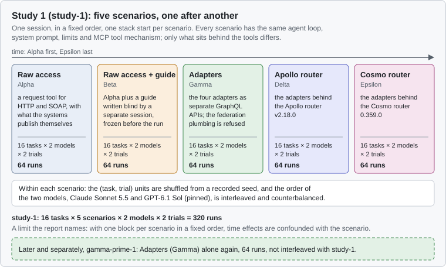
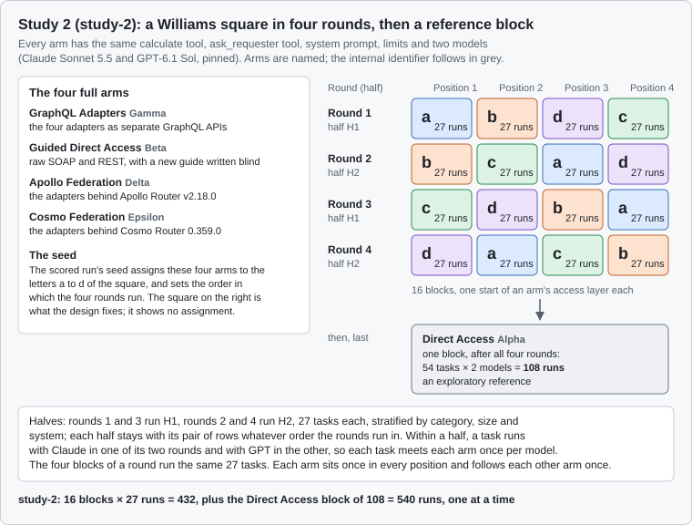

# The two agent studies: design overview

Status: a non-normative overview of the design of Abstraction ladder study 1 and study 2, written on 2026-11-06, after study 2's freeze and before its scored run. Study 2's scored run was done on 2026-11-06 and 2026-11-07, and its results are in [the study 2 report](STUDY-2-REPORT.md) (later context, 2026-11-07). The results of both studies side by side are in [the results page](STUDY-FINDINGS.md) (later context, 2026-11-08). It says what each study asks, how it is built and what study 2 changes, and nothing else: it holds no results, no accuracy, cost or timing figures, no outcome of any run, no task text and no finding about a single task. It governs nothing. These documents govern, and where this page differs from them, they win:

- **Study 2:** the [report](STUDY-2-REPORT.md), the [design](STUDY-2-DESIGN.md), the frozen [analysis plan](../study/analysis2/PLAN.md) and the [freeze record](../study/evidence/study-2-freeze/freeze-record-20261106.json).
- **Study 1:** the [report](AGENT-STUDY-REPORT.md), whose design and methods sections state the analysis plan the lead developer agreed on 2026-10-21, and [the study 1 analysis](../study/analysis/README.md) that implements it.

## At a glance

| | Study 1 (`study-1`) | Study 2 (`study-2`) |
| --- | --- | --- |
| Question | Can an AI agent answer an enterprise's questions over its legacy systems without redesigning them, and what does each integration layer add? | Does federation improve on separate adapters or well-documented direct access? |
| Arms | 5 scenarios | 4 full arms and 1 reference block |
| Models | Claude Sonnet 5.5 and GPT-6.1 Sol, pinned | the same |
| Corpus | 16 tasks in 6 categories | 54 tasks: 48 core tasks in 6 categories and 6 in a separate ambiguity set |
| Repeats | 2 trials per task, scenario and model | 1 run per task, arm and model |
| Schedule | one block per scenario, in a fixed order, in one session | a Williams square of 4 rounds of 4 blocks, then the reference block |
| Calculation | no calculation tool | one shared `calculate` tool in every arm |
| Scoring | by script against expected answers, with no judge | by script against expected answers, with no judge |
| Runs | 320, and 64 more in the later gamma-prime-1 | 540 |

## Study 1

**The question.** Can an AI agent answer an enterprise's questions over its legacy systems without redesigning those systems, and what does each integration layer add? The lab frames it as a ladder with two branches from the raw systems: written knowledge (a guide), or knowledge built into the architecture (adapters, then a federation router) ([agent scenario design](PLAN.md#agent-scenario-design)).

**The comparisons.** Six confirmatory comparisons, Holm-corrected: raw access against the guide, raw access against the Apollo router, the guide against the Apollo router, the two routers against each other, Claude against GPT, and the guide against the Cosmo router. Three of them were also tested for equivalence, at plus or minus 10 and 15 percentage points. The plan was written after a descriptive look at the data; what was fixed before the run (the scenarios, the models and correctness as the primary outcome) carries the confirmatory claims, and the report labels the rest exploratory.

**The measures.** Primary: a correct answer, yes or no. Secondary: run time, tool calls, cost and tokens.

**The scenarios.** The report names them by letter.

- **Alpha, raw access:** a generic HTTP and SOAP request tool, with what the systems publish themselves (the SOAP service's WSDL, the REST contracts) and the mapping release as plain data.
- **Beta, raw access with a guide:** Alpha plus a [guide](../study/guide/README.md) written by a separate session that never saw the questions, frozen before the first run.
- **Gamma, adapters:** the four adapters as separate GraphQL APIs, with the federation plumbing (`_entities`, `_service`) hidden and refused.
- **Delta, the Apollo router:** the adapters behind Apollo Router v2.18.0.
- **Epsilon, the Cosmo router:** the adapters behind Cosmo Router 0.359.0.

Every scenario has the same agent loop, system prompt, limits and tool mechanism; only what sits behind the tools differs. The Missions system behind every scenario was a simulator serving the released dataset, while Personnel and Assets were the real services ([the study testbed](AGENT-STUDY-REPORT.md#correction-2026-10-21-the-study-testbed)).

**The models.** Claude Sonnet 5.5 and GPT-6.1 Sol, both at medium effort, each through its own vendor API with the model pinned.

**The corpus.** 16 scored tasks, frozen with expected answers derived by script from the released data, and a separate development set that was never scored. The questions use the enterprise's words, never schema field names ([corpus](../study/corpus/README.md)).

| Category | Tasks |
| --- | --- |
| A single-system lookup | 3 |
| B cross-system join | 3 |
| C mapping-dependent | 3 |
| D honesty under a stopped service | 2 |
| E aggregation | 3 |
| F deliberate ambiguity | 2 |

**The schedule.** One stack run per scenario, in the fixed order Alpha, Beta, Gamma, Delta, Epsilon, in one session. Within a scenario the (task, trial) units were shuffled from a recorded seed and the order of the two models was interleaved and counterbalanced. The report names the limit this sets: time effects are confounded with the scenario. Later and separately, gamma-prime-1 ran Gamma alone again, after the mapping adapter gained plain lookups, and was not interleaved with study-1.

**The scoring.** Every task ends with a `submit_answer` call whose schema is fixed per task, scored by script against the expected answers: exact, or exact plus declared variants. An answer that claims completeness during an outage is wrong. For the ambiguous tasks a stated definition from a declared list earns full credit and a silent guess scores zero. The free-text explanation is never scored. Limits per run: 80 tool calls, 1,000,000 tokens and 900 seconds.

**The runs.** 16 tasks × 5 scenarios × 2 models × 2 trials = 320 runs; gamma-prime-1 added 64 runs of Gamma.

## Study 2

**The question,** in the lead developer's words: "does federation improve on separate adapters or well-documented direct access?" For the business: document the existing interfaces well, build adapters, or build adapters plus federation? Study 2 is not a replication of study 1, and its accuracy is not pooled with study 1's.

**The comparisons.** Two planned comparisons, Holm-corrected over the two: P1, the mean of Apollo Federation and Cosmo Federation against GraphQL Adapters, and P2, the same mean against Guided Direct Access. Each is also tested for equivalence at plus or minus 10 percentage points, the only predeclared margin. Secondary comparisons form one further Holm family; everything involving Direct Access, the ambiguity set, the size strata, the use of the calculation tool and the results per category is exploratory ([analysis plan](../study/analysis2/PLAN.md)).

**The measures,** reported side by side with no composite score:

1. Accuracy, a correct answer yes or no: the primary measure.
2. Model API cost per run.
3. Elapsed time per run.
4. The honest-gap rate on the controlled-outage tasks.

Tool calls, tokens and calls of the calculation tool are secondary measures.

**The arms.** Reports use the names; the letters in brackets are the internal identifiers of configurations and run keys.

- **GraphQL Adapters** (Gamma): the four adapters as separate GraphQL APIs, `_entities` and `_service` refused. A full arm.
- **Guided Direct Access** (Beta): the raw SOAP and REST interfaces with a new integration guide written blind for study 2. A full arm.
- **Apollo Federation** (Delta): the adapters behind Apollo Router v2.18.0. A full arm.
- **Cosmo Federation** (Epsilon): the adapters behind Cosmo Router 0.359.0. A full arm.
- **Direct Access** (Alpha): the raw SOAP and REST interfaces. An exploratory reference: one complete block.

Every arm has the same calculation tool, the same `ask_requester` tool, system prompt and limits (80 tool calls, 1 M tokens, 900 seconds, 3 retries), the same two models and the same corpus. The Missions system is the real Missions service on Oracle.

**Page fields in the graph arms.** Before the freeze, GraphQL Adapters, Apollo Federation and Cosmo Federation gained `missionsPage` and `assetsPage`, which return the Missions and Assets lists with the service's `totalCount` and `hasMore`. The lists `missions` and `assets` are deprecated and left out of a default introspection, though they still answer. It is an outcome-informed change made before the freeze, and the study report is to say so ([the arms](STUDY-2-DESIGN.md#the-arms)). Direct Access and Guided Direct Access are unchanged.

**The models.** Claude Sonnet 5.5 and GPT-6.1 Sol at medium effort, pinned: the same as study 1.

**The corpus.** 54 tasks in all. The 48 core scored tasks were drawn by a stratified random draw with seed 313 from a pool of 76 questions written in the enterprise's words, all 76 eligible after the answerability check ([the draw](../study/corpus2/README.md#the-draw)). The 6 tasks of the ambiguity set are a separate set and were not drawn. A scripted reference solution per arm proves every task answerable in every arm, every answer key is derived twice, and a development set of 8 tasks, disjoint from the scored set, debugged the harness and the calculation tool. The letters are those of [corpus 2](../study/corpus2/README.md#the-categories); the design calls G "P".

| Category | Tasks |
| --- | --- |
| A single-system lookup | 6 |
| B cross-system join | 10 |
| C mapping-dependent | 8 |
| D honesty under failure (controlled outage) | 8 |
| E aggregation | 10 |
| G pagination and completeness | 6 |
| F ambiguity, scored apart and never in the main accuracy | 6 |

**The schedule.** The four full arms run in 4 rounds of 4 blocks, one block per arm per round; a block is one start of an arm's access layer. The rounds form a Williams Latin square with the letters a to d, so every arm sits once in every position and directly follows every other arm once. The 54 tasks are split into two halves of 27, stratified by category, size and system: rounds 1 and 3 run half H1 and rounds 2 and 4 run half H2, whatever order the rounds run in. Within a half, each task runs with Claude in one of its two rounds and with GPT in the other, so every task meets every arm once per model. The scored run's seed assigns the four arms to the letters and sets the order in which the rounds run; the diagram shows the square the design fixes, not that assignment. The Direct Access block, all 54 tasks with both models, runs last, after all four rounds. Runs go one at a time, and round and session are recorded factors.

**The scoring.** Automatic, against the key, blind to arm and model, with no judge ([corpus 2](../study/corpus2/README.md)). One outcome per run: correct, wrong answer, format error, definition not accepted, abstained, did not finish or vendor error. Primary accuracy counts only correct. The ambiguity set is scored apart, and a clarification counts only from the `ask_requester` log. A vendor error is queued again once, at the end of its block.

**The runs.** 16 blocks × 27 runs = 432, plus the Direct Access block of 108, in all 540 runs.

## What study 2 changes, and why

1. **Interleaved rounds, against one slot per arm.** Study 1 ran each scenario once, in a fixed order, so whatever changed over the session (the vendors' time of day, warm caches, the run before) is mixed into the differences between scenarios. Study 2 gives each full arm four blocks in a Williams square: every arm sits once in every position, and each arm directly follows each other arm exactly once, so position and the run before are balanced. Four rounds are the minimum for both properties.
2. **54 tasks, against 16.** The design's power calculation shows that the number of distinct tasks, not of trials, decides what difference can be detected: the detectable difference falls with the square root of the number of tasks and only a little with the runs per task. At 48 core tasks, P1 and P2 are detectable as superiority at power 0.8 near the 10 percentage points the design calls meaningful ([power](STUDY-2-DESIGN.md#power-tasks-against-trials)). The chance of establishing equivalence at plus or minus 10 percentage points is lower: under the frozen plan's rules, with no true difference, 65 percent for P1 and 52 percent for P2 ([the analysis plan, section 12](../study/analysis2/PLAN.md#12-power-decision-k)).
3. **One run per task, arm and model, against two trials.** For the same reason the budget goes to tasks rather than repeats. Each task runs once per model in each arm, in two different rounds. Running all 54 tasks in every block was not chosen; it gave 4 runs per task and arm at about 1.7 times the scored cost.
4. **The shared calculation tool.** Every arm, Direct Access and Guided Direct Access included, gets the same `calculate` tool: generic operations only, over results the agent obtained in the same run, with no fetching of its own. The tool was declared fit only if it reduced the failures where the agent says it cannot count and the failures from token volume, while the definitional failures stay as they are and no new kind of failure appears ([the tools](STUDY-2-DESIGN.md#the-tools)). Study 2 therefore compares access architectures that share calculation support; there is no arm with and without the tool.
5. **Direct Access as a reference block.** Direct Access runs as one complete block, after all four rounds, outside the balanced square. Placing it last keeps it from preceding any arm of the square. It is a new reference measurement under study 2's conditions, not a check that study 1 replicates, and it is exploratory: with one block its performance is confounded with the time window in which it ran.

Other differences of study 2: the real Missions service on Oracle where study 1 had a simulator; page fields with the service's totals in the three graph arms, an outcome-informed change made before the freeze ([the arms](STUDY-2-DESIGN.md#the-arms)); a new guide for Guided Direct Access, written blind (study 1's guide stays unchanged); a reference solution per arm, where study 1 checked answerability in one scenario only; descriptive arm names; the `ask_requester` tool with the ambiguity set scored apart; and abstained as an outcome of its own.
