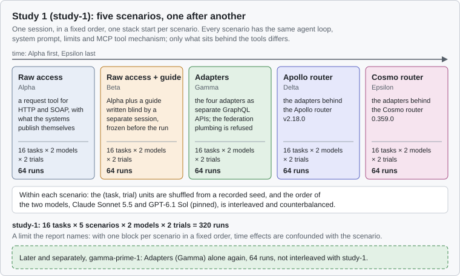
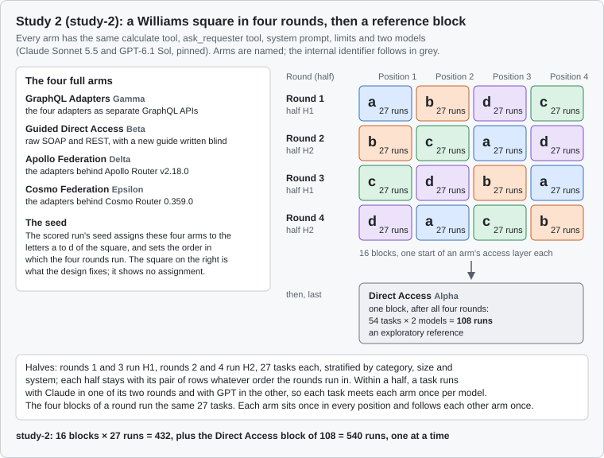
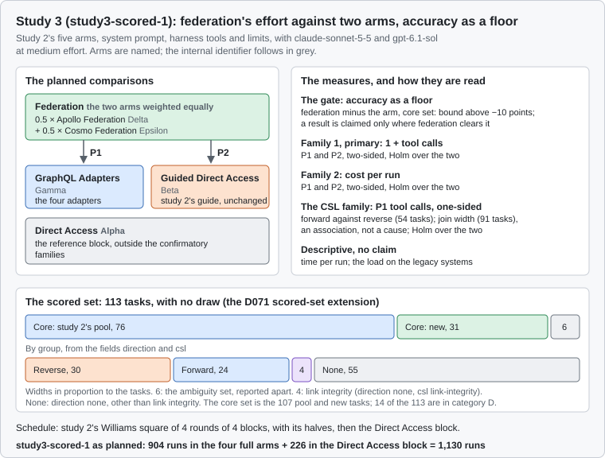

# The three agent studies: design overview

Status: a non-normative overview of the design of Abstraction ladder study 1 and study 2, written on 2026-11-06, after study 2's freeze and before its scored run. Study 2's scored run was done on 2026-11-06 and 2026-11-07, and its results are in [the study 2 report](STUDY-2-REPORT.md) (later context, 2026-11-07). The results of both studies side by side are in [the results page](STUDY-FINDINGS.md) (later context, 2026-11-08). Study 3's results are in [the study 3 report](STUDY-3-REPORT.md) (later context, 2026-11-26). Study 3's design, a Study 3 column in At a glance and what study 3 changes were added on 2026-11-26, from [study 3's design page](STUDY-3-DESIGN.md) and the sources it names, read without study 3's results; so where the next sentence says what the page holds, it now also says what study 3 changes, and study 3's part holds no result either (later context, 2026-11-26). It says what each study asks, how it is built and what study 2 changes, and nothing else: it holds no results, no accuracy, cost or timing figures, no outcome of any run, no task text and no finding about a single task. It governs nothing. These documents govern, and where this page differs from them, they win:

- **Study 3:** the frozen [analysis plan](../study/analysis3/PLAN.md), decisions [D068 to D074](../project-governance/DECISIONS.md) and the [freeze record](../study/evidence/study-3-freeze/freeze-record-20261122.json). Its [design page](STUDY-3-DESIGN.md) was written after its scored run from sources frozen or decided before it, and is non-normative.
- **Study 2:** the [report](STUDY-2-REPORT.md), the [design](STUDY-2-DESIGN.md), the frozen [analysis plan](../study/analysis2/PLAN.md) and the [freeze record](../study/evidence/study-2-freeze/freeze-record-20261106.json).
- **Study 1:** the [report](AGENT-STUDY-REPORT.md), whose design and methods sections state the analysis plan the lead developer agreed on 2026-10-21, and [the study 1 analysis](../study/analysis/README.md) that implements it.

## At a glance

| | Study 1 (`study-1`) | Study 2 (`study-2`) | Study 3 (`study3-scored-1`) |
| --- | --- | --- | --- |
| Question | Can an AI agent answer an enterprise's questions over its legacy systems without redesigning them, and what does each integration layer add? | Does federation improve on separate adapters or well-documented direct access? | Does GraphQL federation reduce agent effort (tool calls, cost) on cross-system lookups, with accuracy only as a floor? |
| Arms | 5 scenarios | 4 full arms and 1 reference block | study 2's 4 full arms and 1 reference block |
| Models | Claude Sonnet 5.5 and GPT-6.1 Sol, pinned | the same | the same, each named with its request settings in the freeze record |
| Corpus | 16 tasks in 6 categories | 54 tasks: 48 core tasks in 6 categories and 6 in a separate ambiguity set | 113 tasks, with no draw: 107 core tasks (study 2's pool of 76 and 31 new) and study 2's 6 ambiguity tasks, reported apart |
| Repeats | 2 trials per task, scenario and model | 1 run per task, arm and model | 1 run per task, arm and model |
| Schedule | one block per scenario, in a fixed order, in one session | a Williams square of 4 rounds of 4 blocks, then the reference block | study 2's Williams square and halves, then the reference block |
| Calculation | no calculation tool | one shared `calculate` tool in every arm | study 2's `calculate` tool in every arm |
| Scoring | by script against expected answers, with no judge | by script against expected answers, with no judge | by script against expected answers, with no judge (corpus 2's scorer, byte for byte) |
| Runs | 320, and 64 more in the later gamma-prime-1 | 540 | 1,130 |

## Study 1

**The question.** Can an AI agent answer an enterprise's questions over its legacy systems without redesigning those systems, and what does each integration layer add? The lab frames it as a ladder with two branches from the raw systems: written knowledge (a guide), or knowledge built into the architecture (adapters, then a federation router) ([agent scenario design](PLAN.md#agent-scenario-design)).

**The comparisons.** Six confirmatory comparisons, Holm-corrected: raw access against the guide, raw access against the Apollo router, the guide against the Apollo router, the two routers against each other, Claude against GPT, and the guide against the Cosmo router. Three of them were also tested for equivalence, at plus or minus 10 and 15 percentage points. The plan was written after a descriptive look at the data; what was fixed before the run (the scenarios, the models and correctness as the primary outcome) carries the confirmatory claims, and the report labels the rest exploratory.

**The measures.** Primary: a correct answer, yes or no. Secondary: run time, tool calls, cost and tokens.

**The scenarios.** The report names them by letter.

- **Alpha, raw access:** a generic HTTP and SOAP request tool, with what the systems publish themselves (the SOAP service's WSDL, the REST contracts) and the mapping release as plain data.
- **Beta, raw access with a guide:** Alpha plus a [guide](../study/guide/README.md) written by a separate session that never saw the questions, frozen before the first run.
- **Gamma, adapters:** the four adapters as separate GraphQL APIs, with the federation plumbing (`_entities`, `_service`) hidden and refused.
- **Delta, the Apollo router:** the adapters behind Apollo Router v2.18.0.
- **Epsilon, the Cosmo router:** the adapters behind Cosmo Router 0.359.0.

Every scenario has the same agent loop, system prompt, limits and tool mechanism; only what sits behind the tools differs. The Missions system behind every scenario was a simulator serving the released dataset, while Personnel and Assets were the real services ([the study testbed](AGENT-STUDY-REPORT.md#correction-2026-10-21-the-study-testbed)).

**The models.** Claude Sonnet 5.5 and GPT-6.1 Sol, both at medium effort, each through its own vendor API with the model pinned.

**The corpus.** 16 scored tasks, frozen with expected answers derived by script from the released data, and a separate development set that was never scored. The questions use the enterprise's words, never schema field names ([corpus](../study/corpus/README.md)).

| Category | Tasks |
| --- | --- |
| A single-system lookup | 3 |
| B cross-system join | 3 |
| C mapping-dependent | 3 |
| D honesty under a stopped service | 2 |
| E aggregation | 3 |
| F deliberate ambiguity | 2 |

**The schedule.** One stack run per scenario, in the fixed order Alpha, Beta, Gamma, Delta, Epsilon, in one session. Within a scenario the (task, trial) units were shuffled from a recorded seed and the order of the two models was interleaved and counterbalanced. The report names the limit this sets: time effects are confounded with the scenario. Later and separately, gamma-prime-1 ran Gamma alone again, after the mapping adapter gained plain lookups, and was not interleaved with study-1.

**The scoring.** Every task ends with a `submit_answer` call whose schema is fixed per task, scored by script against the expected answers: exact, or exact plus declared variants. An answer that claims completeness during an outage is wrong. For the ambiguous tasks a stated definition from a declared list earns full credit and a silent guess scores zero. The free-text explanation is never scored. Limits per run: 80 tool calls, 1,000,000 tokens and 900 seconds.

**The runs.** 16 tasks × 5 scenarios × 2 models × 2 trials = 320 runs; gamma-prime-1 added 64 runs of Gamma.

## Study 2

**The question,** in the lead developer's words: "does federation improve on separate adapters or well-documented direct access?" For the business: document the existing interfaces well, build adapters, or build adapters plus federation? Study 2 is not a replication of study 1, and its accuracy is not pooled with study 1's.

**The comparisons.** Two planned comparisons, Holm-corrected over the two: P1, the mean of Apollo Federation and Cosmo Federation against GraphQL Adapters, and P2, the same mean against Guided Direct Access. Each is also tested for equivalence at plus or minus 10 percentage points, the only predeclared margin. Secondary comparisons form one further Holm family; everything involving Direct Access, the ambiguity set, the size strata, the use of the calculation tool and the results per category is exploratory ([analysis plan](../study/analysis2/PLAN.md)).

**The measures,** reported side by side with no composite score:

1. Accuracy, a correct answer yes or no: the primary measure.
2. Model API cost per run.
3. Elapsed time per run.
4. The honest-gap rate on the controlled-outage tasks.

Tool calls, tokens and calls of the calculation tool are secondary measures.

**The arms.** Reports use the names; the letters in brackets are the internal identifiers of configurations and run keys.

- **GraphQL Adapters** (Gamma): the four adapters as separate GraphQL APIs, `_entities` and `_service` refused. A full arm.
- **Guided Direct Access** (Beta): the raw SOAP and REST interfaces with a new integration guide written blind for study 2. A full arm.
- **Apollo Federation** (Delta): the adapters behind Apollo Router v2.18.0. A full arm.
- **Cosmo Federation** (Epsilon): the adapters behind Cosmo Router 0.359.0. A full arm.
- **Direct Access** (Alpha): the raw SOAP and REST interfaces. An exploratory reference: one complete block.

Every arm has the same calculation tool, the same `ask_requester` tool, system prompt and limits (80 tool calls, 1 M tokens, 900 seconds, 3 retries), the same two models and the same corpus. The Missions system is the real Missions service on Oracle.

**Page fields in the graph arms.** Before the freeze, GraphQL Adapters, Apollo Federation and Cosmo Federation gained `missionsPage` and `assetsPage`, which return the Missions and Assets lists with the service's `totalCount` and `hasMore`. The lists `missions` and `assets` are deprecated and left out of a default introspection, though they still answer. It is an outcome-informed change made before the freeze, and the study report is to say so ([the arms](STUDY-2-DESIGN.md#the-arms)). Direct Access and Guided Direct Access are unchanged.

**The models.** Claude Sonnet 5.5 and GPT-6.1 Sol at medium effort, pinned: the same as study 1.

**The corpus.** 54 tasks in all. The 48 core scored tasks were drawn by a stratified random draw with seed 313 from a pool of 76 questions written in the enterprise's words, all 76 eligible after the answerability check ([the draw](../study/corpus2/README.md#the-draw)). The 6 tasks of the ambiguity set are a separate set and were not drawn. A scripted reference solution per arm proves every task answerable in every arm, every answer key is derived twice (the second derivation's key answers passed the first's scoring checks on all 54 scored tasks; its package contained no answer-bearing design note for 39 of those tasks, and for the other 15 it had access to answer guidance, as [corpus 2](../study/corpus2/README.md#files) says), and a development set of 8 tasks, disjoint from the scored set, debugged the harness and the calculation tool. The letters are those of [corpus 2](../study/corpus2/README.md#the-categories); the design calls G "P".

| Category | Tasks |
| --- | --- |
| A single-system lookup | 6 |
| B cross-system join | 10 |
| C mapping-dependent | 8 |
| D honesty under failure (controlled outage) | 8 |
| E aggregation | 10 |
| G pagination and completeness | 6 |
| F ambiguity, scored apart and never in the main accuracy | 6 |

**The schedule.** The four full arms run in 4 rounds of 4 blocks, one block per arm per round; a block is one start of an arm's access layer. The rounds form a Williams Latin square with the letters a to d, so every arm sits once in every position and directly follows every other arm once. The 54 tasks are split into two halves of 27, stratified by category, size and system: rounds 1 and 3 run half H1 and rounds 2 and 4 run half H2, whatever order the rounds run in. Within a half, each task runs with Claude in one of its two rounds and with GPT in the other, so every task meets every arm once per model. The scored run's seed assigns the four arms to the letters and sets the order in which the rounds run; the diagram shows the square the design fixes, not that assignment. The Direct Access block, all 54 tasks with both models, runs last, after all four rounds. Runs go one at a time, and round and session are recorded factors.

**The scoring.** Automatic, against the key, blind to arm and model, with no judge ([corpus 2](../study/corpus2/README.md)). One outcome per run: correct, wrong answer, format error, definition not accepted, abstained, did not finish or vendor error. Primary accuracy counts only correct. The ambiguity set is scored apart, and a clarification counts only from the `ask_requester` log. A vendor error is queued again once, at the end of its block.

**The runs.** 16 blocks × 27 runs = 432, plus the Direct Access block of 108, in all 540 runs.

## What study 2 changes, and why

1. **Interleaved rounds, against one slot per arm.** Study 1 ran each scenario once, in a fixed order, so whatever changed over the session (the vendors' time of day, warm caches, the run before) is mixed into the differences between scenarios. Study 2 gives each full arm four blocks in a Williams square: every arm sits once in every position, and each arm directly follows each other arm exactly once, so position and the run before are balanced. Four rounds are the minimum for both properties.
2. **54 tasks, against 16.** The design's power calculation shows that the number of distinct tasks, not of trials, decides what difference can be detected: the detectable difference falls with the square root of the number of tasks and only a little with the runs per task. At 48 core tasks, P1 and P2 are detectable as superiority at power 0.8 near the 10 percentage points the design calls meaningful ([power](STUDY-2-DESIGN.md#power-tasks-against-trials)). The chance of establishing equivalence at plus or minus 10 percentage points is lower: under the frozen plan's rules, with no true difference, 65 percent for P1 and 52 percent for P2 ([the analysis plan, section 12](../study/analysis2/PLAN.md#12-power-decision-k)).
3. **One run per task, arm and model, against two trials.** For the same reason the budget goes to tasks rather than repeats. Each task runs once per model in each arm, in two different rounds. Running all 54 tasks in every block was not chosen; it gave 4 runs per task and arm at about 1.7 times the scored cost.
4. **The shared calculation tool.** Every arm, Direct Access and Guided Direct Access included, gets the same `calculate` tool: generic operations only, over results the agent obtained in the same run, with no fetching of its own. The tool was declared fit only if it reduced the failures where the agent says it cannot count and the failures from token volume, while the definitional failures stay as they are and no new kind of failure appears ([the tools](STUDY-2-DESIGN.md#the-tools)). Study 2 therefore compares access architectures that share calculation support; there is no arm with and without the tool.
5. **Direct Access as a reference block.** Direct Access runs as one complete block, after all four rounds, outside the balanced square. Placing it last keeps it from preceding any arm of the square. It is a new reference measurement under study 2's conditions, not a check that study 1 replicates, and it is exploratory: with one block its performance is confounded with the time window in which it ran.

Other differences of study 2: the real Missions service on Oracle where study 1 had a simulator; page fields with the service's totals in the three graph arms, an outcome-informed change made before the freeze ([the arms](STUDY-2-DESIGN.md#the-arms)); a new guide for Guided Direct Access, written blind (study 1's guide stays unchanged); a reference solution per arm, where study 1 checked answerability in one scenario only; descriptive arm names; the `ask_requester` tool with the ambiguity set scored apart; and abstained as an outcome of its own.

## Study 3

**The question.** Does GraphQL federation reduce agent effort (tool calls, cost) on cross-system lookups, with accuracy only as a floor ([the question](STUDY-3-DESIGN.md#the-question-and-what-better-means))? A cross-system lookup (CSL) is a reverse lookup, a link-integrity question or an aggregate over joined data; an aggregate is a CSL only when it starts from the far side, per person or per asset. Forward joins stay their own category and are the comparison ([D068](../project-governance/DECISIONS.md#d068---study-3-decision-1-what-counts-as-a-cross-system-lookup-2026-11-10-refined-2026-11-11-accepted)). Study 3 is strand 1; strand 2 is postponed ([D074](../project-governance/DECISIONS.md#d074---study-3-decision-8-strand-1-only-strand-2-postponed-2026-11-10-revised-2026-11-17-accepted)).

**The comparisons.** Two planned comparisons: P1, federation against GraphQL Adapters, and P2, federation against Guided Direct Access, where federation is 0.5 Apollo Federation + 0.5 Cosmo Federation, the two arms weighted equally. In each effort family P1 and P2 are tested two-sided at 0.05, with Holm over the two. The CSL family is two one-sided tests on P1 tool calls, with Holm over the two: forward against reverse, fitted on the 54 forward and reverse tasks, tests whether the advantage is smaller on reverse questions; join width, fitted on the 91 tasks of the join-width groups, tests whether it is larger on questions that read several systems, and its result is an association within this corpus, not a cause ([the CSL family](STUDY-3-DESIGN.md#the-csl-family-confirmatory)). An effort result against an arm is claimed only if it is significant after Holm and federation clears the accuracy floor against that arm; a CSL result only if it is significant after Holm and federation clears the floor against GraphQL Adapters on the core set ([what can be claimed](STUDY-3-DESIGN.md#what-can-be-claimed)). Time, the other arm pairs, Direct Access, the ambiguity set and the results per category, size, anchor and CSL kind are descriptive or exploratory ([analysis plan](../study/analysis3/PLAN.md#10-descriptive-and-exploratory-results-labelled-so)).

**The measures** ([D069](../project-governance/DECISIONS.md#d069---study-3-decision-2-tool-calls-and-cost-as-two-confirmatory-families-2026-11-10-accepted), [D070](../project-governance/DECISIONS.md#d070---study-3-decision-3-accuracy-as-a-floor-2026-11-10-accepted), [D073](../project-governance/DECISIONS.md#d073---study-3-decision-6-legacy-load-descriptive-2026-11-10-accepted)), reported in tiers kept apart:

1. Tool calls, 1 + the tool calls of a run: the primary confirmatory family.
2. Cost per run: a second confirmatory family.
3. Accuracy: a non-inferiority floor of 10 percentage points that gates the effort results; it is not a claim.
4. Time per run: descriptive, with intervals and no claim.
5. The load on the legacy systems: the requests to Missions, Personnel and Assets per run and arm, descriptive, as ratios with intervals and no claim. The raw arms' requests are in their transcripts; for the GraphQL arms a compose overlay turns on the request log in the three adapters, with no image change ([the legacy-load record](STUDY-3-DESIGN.md#the-legacy-load-record)).

**The arms.** Study 2's five, with the same names; the letters in brackets are the internal identifiers of configurations, run keys and bundles ([the arms](STUDY-3-DESIGN.md#the-arms)).

- **Guided Direct Access** (Beta): a full arm. It reads study 2's frozen guide, unchanged ([D072](../project-governance/DECISIONS.md#d072---study-3-decision-5-study-2s-guide-unchanged-2026-11-10-accepted)).
- **GraphQL Adapters** (Gamma): a full arm.
- **Apollo Federation** (Delta): a full arm, one half of federation.
- **Cosmo Federation** (Epsilon): a full arm, the other half of federation.
- **Direct Access** (Alpha): the reference block, outside the confirmatory families.

The system prompt, the harness tools (`calculate` and `ask_requester`) and the limits are equal to study 2's in every arm. Every scenario starts the whole federation stack: the backends, the four adapters and one router, Cosmo for Epsilon and Apollo otherwise. The Missions system is the real Missions service on Oracle, with the same dataset fingerprint as study 2's ([the backend](STUDY-3-DESIGN.md#the-backend)).

**The models.** `claude-sonnet-5-5` (adaptive thinking, effort medium) and `gpt-6.1-sol` (reasoning effort medium, not stored), each with at most 16,000 output tokens, named with their request settings in the [freeze record](../study/evidence/study-3-freeze/freeze-record-20261122.json).

**The corpus.** [Corpus 3](../study/corpus3/README.md) is study 2's checked pool and ambiguity set, carried byte for byte, plus 31 new tasks: 27 in the reverse group and 4 forward tasks that read all three systems. There is no draw ([D071](../project-governance/DECISIONS.md#d071---study-3-decision-4-the-whole-pool-one-run-per-question-arm-and-model-2026-11-10-accepted)). The scored set is the frozen `tasks.json`, as the [D071 scored-set extension](../project-governance/DECISIONS.md#d071-scored-set-extension-2026-11-26) names it: study 2's 76 pool tasks, the 31 new tasks and study 2's 6 ambiguity tasks, reported apart; the core set is the 107 pool and new tasks. The extension is dated 2026-11-26, after the run; it records the corpus decisions C2, C3 and C7 of 2026-11-13 and binds where D071's wording ("every checked pool question plus the new CSL questions") differs. A development set of 8 tasks, corpus 2's byte for byte, is never scored.

| Set | Tasks |
| --- | --- |
| Core: study 2's pool | 76 |
| Core: new | 31 |
| Ambiguity set, reported apart | 6 |
| Scored set, in all | 113, of which 14 in category D (run under an outage) |

The new tasks are 10 reverse lookups from a person, 8 reverse lookups from an asset, 9 far-side aggregates and 4 forward tasks over all three systems; their sizes are 10 small, 17 medium and 4 large. Categories keep study 2's letters: a reverse lookup is B or C, a far-side aggregate is E. Each scored task has direction fields, among them `direction` and `csl`, set by one rule from its set, category, anchor and required systems ([the direction fields](../study/corpus3/README.md#the-direction-fields)). They give four groups:

| Group | `direction` | `csl` | Tasks |
| --- | --- | --- | --- |
| Reverse: 20 reverse lookups and 10 far-side aggregates | `reverse` | `reverse-lookup` or `far-side-aggregate` | 30 |
| Forward: 20 carried and the 4 new | `forward` | - | 24 |
| Link integrity, reported as its own group | `none` | `link-integrity` | 4 |
| None: the ambiguity set, category D and the rest | `none` | - | 55 |

The join-width groups are drawn from the 107 core tasks, the set the confirmatory families count, and read the required systems, never the anchor: without category D and the 2 tasks that read no system, 39 tasks read one system and 52 several, 91 in all ([plan, sections 2 and 3](../study/analysis3/PLAN.md#2-what-is-read-about-a-task)). A second derivation of the 31 new keys, written blind to the first, found no difference on any of them, and a reference solution per task checks that it is answerable in every arm ([the corpus](STUDY-3-DESIGN.md#the-corpus)).

**The schedule.** Study 2's block schedule, `williams-4-half`: the four full arms in a Williams square of 4 rounds of 4 blocks, with study 2's halves and its split between the models, and the Direct Access reference block, which came last in the scored plan as the freeze's dry runs ran it ([the schedule](STUDY-3-DESIGN.md#the-schedule)). Every task runs with both models in every arm. The scored run's seed, its budget and any top-up were not set at the freeze, and this page does not describe them.

**The scoring.** Automatic, against the key, with no judge: corpus 2's scorer, byte for byte, under scoring contract version 2 ([the freeze](STUDY-3-DESIGN.md#the-freeze)). Study 2's counting rules apply unchanged. Effort counts every scored run of the four full arms on the core set, right or wrong, and a vendor error is queued again once ([which runs count](STUDY-3-DESIGN.md#which-runs-count)). Limits per run, study 2's: 80 tool calls, 1,000,000 tokens and 900 seconds, and 3 retries of a request, 5 seconds apart, with at most 2 nudges. A run stopped at a limit is `did_not_finish` and counts for effort with its calls and cost.

**The runs.** 113 tasks × 5 arms × 2 models = 1,130 runs in 17 blocks, 226 per arm: 904 in the four full arms and 226 in the Direct Access block. The rationale of D071 gives about 850 runs in the four full arms, as estimated then; the rationale is non-normative, so the freeze record's plan binds ([cost](STUDY-3-DESIGN.md#cost)).

## What study 3 changes, and why

1. **Effort as the primary outcome, against accuracy.** The frozen plan says: "Effort is the primary outcome and accuracy is a floor. Study 2 made accuracy primary; every full arm was at or near 100 percent, its primary model could not be fitted, and effort, which did separate the arms, had been labelled exploratory in advance." ([the analysis plan](../study/analysis3/PLAN.md)). The rationale of D069 adds that only a new run under a plan frozen first can make effort confirmatory, that 1 + tool calls is the most stable measure and the least vendor-dependent, and that time is the most tied to vendor speed and stays descriptive. Tool calls and cost are two families rather than one family of six, which would cost the primary up to 19 points of power. Accuracy becomes a floor at study 2's justified margin of 10 points and a gate on each effort result ([D070](../project-governance/DECISIONS.md#d070---study-3-decision-3-accuracy-as-a-floor-2026-11-10-accepted)), so there is no claim that accuracy is superior ([rationale](../project-governance/RATIONALE.md#study-3-design-d068-d074)).
2. **Cross-system lookups as a group of their own.** A cross-system lookup has an answer only where the systems meet, and only the mapping knows the global ids, so these are the graph's own capabilities ([D068](../project-governance/DECISIONS.md#d068---study-3-decision-1-what-counts-as-a-cross-system-lookup-2026-11-10-refined-2026-11-11-accepted)). Forward joins stay study 2's cross-system join and are the comparison; only far-side aggregates count. The narrower definition needs new questions, hence the 27 new tasks in the reverse group, and only "the advantage disappears on reverse" is testable at a feasible size ([D071](../project-governance/DECISIONS.md#d071---study-3-decision-4-the-whole-pool-one-run-per-question-arm-and-model-2026-11-10-accepted); [rationale](../project-governance/RATIONALE.md#study-3-design-d068-d074)).
3. **The whole pool, against a draw of 48.** The power calculation behind D071: tool calls on P2 need 76 to 90 questions for a power of 0.84 or more if the effect shrinks by a quarter, forward against reverse needs about 30 and 30, and more questions help more than repeats. A draw with quotas, as in study 2, was rejected: the pool keeps study 2's coverage at about 1.4 times its quotas, and study 2's 48 drawn tasks are a subset of it. The cost is more runs and more spend ([rationale](../project-governance/RATIONALE.md#study-3-design-d068-d074)).
4. **Study 2's guide, unchanged, against a new guide.** Study 2's frozen guide was written blind to study 2's corpus and may say nothing about reverse lookups; the graph is not extended for CSL either, so neither side gets help, and both are tested as a business has them today ([D072](../project-governance/DECISIONS.md#d072---study-3-decision-5-study-2s-guide-unchanged-2026-11-10-accepted)). Whether the guide copes is part of what is measured, and CSL results may reflect the guide's silence as well as the graph ([rationale](../project-governance/RATIONALE.md#study-3-design-d068-d074)).
5. **The legacy load, recorded.** The router's per-reference fetches (no caching, no batching) may raise the requests to the legacy systems, so the load is reported descriptively, as ratios with intervals ([D073](../project-governance/DECISIONS.md#d073---study-3-decision-6-legacy-load-descriptive-2026-11-10-accepted)). A third confirmatory family was rejected: the direction was not predicted, and it would take power ([rationale](../project-governance/RATIONALE.md#study-3-design-d068-d074)).

Other differences of study 3: the warm-up of Apollo Federation and Cosmo Federation resolves one Personnel reference, so the Personnel adapter reads its whole snapshot before the first scored run, where study 2's warm-up reached no legacy system ([the legacy-load record](STUDY-3-DESIGN.md#the-legacy-load-record)); each request is priced on its own from the price table dated 2026-11-21, with OpenAI cache writes and the long-context rates ([cost](STUDY-3-DESIGN.md#cost)); and study 3 is strand 1 alone, with strand 2 postponed, so it answers what federation saves each consumer per question, not what it saves the organization when a system changes ([D074](../project-governance/DECISIONS.md#d074---study-3-decision-8-strand-1-only-strand-2-postponed-2026-11-10-revised-2026-11-17-accepted); [rationale](../project-governance/RATIONALE.md#study-3-design-d068-d074)).
